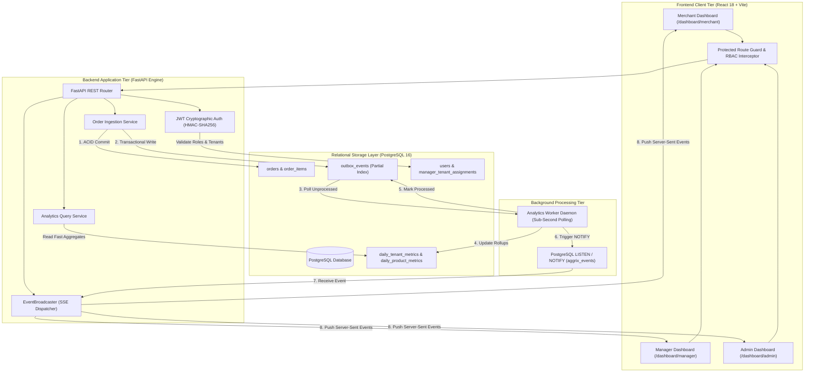

# AGGRIX – Multi-Tenant Analytics & Aggregation Engine

### *One Platform. Multiple Businesses. Unified Analytics.*

[](https://www.python.org/)
[](https://fastapi.tiangolo.com/)
[](https://react.dev/)
[](https://www.typescriptlang.org/)
[](https://www.postgresql.org/)
[](https://www.docker.com/)
[](file:///tests/)
[](file:///frontend/)
[](file:///docs/)
[](LICENSE)

**AGGRIX** is a high-performance, multi-tenant analytics and order aggregation platform engineered to help modern commerce businesses manage, ingest, process, and analyze order data across multiple stores through a single centralized engine. 

Designed around Shopify-inspired architectural isolation, AGGRIX delivers **role-oriented real-time glassmorphic dashboards**, **centralized high-throughput order ingestion**, **transactional outbox event streaming**, **sub-second asynchronous worker aggregation**, and **cryptographically enforced backend authorization** across all tenant boundaries.

---

## Table of Contents

- [1. Introduction](#1-introduction)
- [2. Problem Statement](#2-problem-statement)
- [3. Our Solution](#3-our-solution)
- [4. Project Objectives](#4-project-objectives)
- [5. Key Features](#5-key-features)
  - [5.1 Multi-Tenant Architecture](#51-multi-tenant-architecture)
  - [5.2 Merchant Dashboard](#52-merchant-dashboard)
  - [5.3 Manager Dashboard](#53-manager-dashboard)
  - [5.4 Platform Admin Dashboard](#54-platform-admin-dashboard)
  - [5.5 Order Ingestion](#55-order-ingestion)
  - [5.6 Background Processing & Transactional Outbox](#56-background-processing--transactional-outbox)
  - [5.7 Real-Time Updates via SSE](#57-real-time-updates-via-sse)
  - [5.8 Centralized Analytics Engine](#58-centralized-analytics-engine)
  - [5.9 Authentication and Authorization (RBAC)](#59-authentication-and-authorization-rbac)
- [6. Understanding Multi-Tenancy](#6-understanding-multi-tenancy)
- [7. User Roles & Access Control](#7-user-roles--access-control)
- [8. System Architecture](#8-system-architecture)
- [9. How AGGRIX Works](#9-how-aggrix-works)
- [10. Technology Stack](#10-technology-stack)
- [11. Docker and Containerization](#11-docker-and-containerization)
- [12. Project Structure](#12-project-structure)
- [13. Installation and Setup](#13-installation-and-setup)
- [14. API Documentation](#14-api-documentation)
- [15. Order Ingestion and Processing](#15-order-ingestion-and-processing)
- [16. Real-Time Updates](#16-real-time-updates)
- [17. Database and Data Management](#17-database-and-data-management)
- [18. Testing and Validation](#18-testing-and-validation)
- [19. Running the Demo & Persona Credentials](#19-running-the-demo--persona-credentials)
- [20. Current Implementation and Limitations](#20-current-implementation-and-limitations)
- [21. Future Enhancements](#21-future-enhancements)
- [22. Why AGGRIX Matters](#22-why-aggrix-matters)

---

## 1. Introduction

Businesses operating across multiple stores, regional branches, or diverse sales channels frequently struggle to maintain a unified, real-time view of their commercial operations. 

Order information typically ends up fragmented across siloed systems, third-party marketplaces, and independent databases. This fragmentation creates significant hurdles: business owners cannot monitor real-time gross revenue, store managers lack clear visibility into their assigned branch performance, and executives are forced to execute slow, manual data reconciliations.

**AGGRIX** resolves this fundamental operational bottleneck by centralizing order data into a multi-tenant aggregation engine. Engineered with strict logical separation at the database layer, AGGRIX allows multiple independent businesses to run concurrently on shared infrastructure while guaranteeing complete data isolation.

Through tailored, role-oriented user interfaces, AGGRIX surfaces actionable operational intelligence across three distinct operational tiers:
1. **Individual Business / Merchant Level**: Real-time sales, order status breakdowns, top-selling inventory, and chronological volume trends for single stores.
2. **Store Management Level**: Consolidated multi-store portfolios, assigned branch comparisons, and currency-segregated revenue rollups.
3. **Platform Administration Level**: Platform-wide tenant governance, global outbox event throughput, and PostgreSQL schema health.

AGGRIX converts distributed transactional data into reliable, auditable, and instantaneous business intelligence.

---

## 2. Problem Statement

Retail groups, franchise operators, and e-commerce enterprises managing distributed sales channels encounter five chronic architectural challenges:

* **Fragmented Order Data**: Sales records are dispersed across disparate systems, formats, and regional platforms without a centralized ledger.
* **Lack of Centralized Analytics**: Executives must manually consolidate spreadsheets to analyze overall performance, introducing human error and stale metrics.
* **Limited Store-Level Visibility**: Multi-store managers need to compare their assigned store portfolios without exposing confidential metrics from unassigned businesses.
* **Delayed Business Insights**: Batch-oriented analytics running overnight fail to provide immediate operational feedback during peak sales periods.
* **Data Isolation & Security Challenges**: Shared multi-tenant applications risk catastrophic cross-tenant data leakage if access controls rely solely on frontend filters or client-supplied identifiers.

> [!IMPORTANT]
> **The Core Problem**: How can multiple independent businesses ingest, process, and analyze their order data through one centralized system while guaranteeing absolute tenant data isolation, preventing privilege escalation, and providing sub-second analytics?

---

## 3. Our Solution

AGGRIX delivers an integrated, event-driven engine combining API order ingestion, relational data storage, transactional outbox streaming, background worker aggregation, and real-time Server-Sent Events (SSE).

| Operational Challenge | Traditional Approach | AGGRIX Solution |
| :--- | :--- | :--- |
| **Distributed Orders** | Siloed regional databases | **Centralized RESTful Order Ingestion** (Single & Batch) |
| **Multi-Business Support** | Expensive isolated deployments | **Shared Schema Multi-Tenancy** with Composite Foreign Keys |
| **Access Boundaries** | Hardcoded client view toggles | **Strict Role-Based Access Control (RBAC)** enforced at DB level |
| **Reporting Delays** | Slow batch queries on OLTP tables | **Precomputed Daily Summary Rollups** updated in sub-seconds |
| **Event Reliability** | Dual-write patterns prone to failure | **Transactional Outbox Pattern** ensuring zero lost events |
| **Data Latency** | Manual dashboard page reloads | **Server-Sent Events (SSE)** delivering live push updates |
| **Security Leakage** | Trusting client-side parameters | **Cryptographic JWT Validation** & server-side tenant scoping |

Instead of treating every store as a detached software stack, AGGRIX delivers a unified platform with built-in tenant isolation, auditability, and sub-second live analytics.

---

## 4. Project Objectives

1. **Centralized Order Aggregation**: Provide high-throughput endpoints to ingest single and batch orders with deduplication guarantees.
2. **Shopify-Inspired Multi-Tenancy**: Support multiple businesses on a shared PostgreSQL 16 schema with strict database-level composite foreign key boundaries.
3. **Role-Oriented Dashboards**: Deliver purpose-built glassmorphic dashboards for Merchants, Store Managers, and Platform Administrators.
4. **Reliable Relational Storage**: Persist orders, line items, customers, and catalog items with transactional consistency and referential integrity.
5. **Asynchronous Background Processing**: Implement an autonomous worker daemon utilizing the Transactional Outbox pattern to decouple ingestion from analytics.
6. **Precomputed Aggregation Rollups**: Maintain pre-aggregated daily metric tables (`daily_tenant_metrics`, `daily_product_metrics`) for constant-time analytics queries.
7. **Real-Time Push Notifications**: Stream live order events to client dashboards via persistent Server-Sent Events (SSE) and PostgreSQL `LISTEN/NOTIFY`.
8. **Cryptographic Authentication & Authorization**: Enforce JWT validation and backend RBAC dependencies on every protected endpoint (HTTP 401/403).
9. **Eliminate Privilege Escalation**: Protect frontend routes, hide unauthorized navigation links, and prevent client-side credential spoofing.
10. **Containerized Workflow**: Provide a turn-key Docker Compose development and deployment pipeline running backend, database, and worker services.

---

## 5. Key Features

### 5.1 Multi-Tenant Architecture
* **Physical Isolation**: All core business tables (`orders`, `order_items`, `customers`, `products`) bind to `tenant_id`.
* **Composite Foreign Keys**: Constraints like `(tenant_id, customer_id) REFERENCES customers(tenant_id, id)` ensure customer records cannot be crossed between stores at the database engine level.

### 5.2 Merchant Dashboard
* Real-time metrics for single-store operators: Total Orders, Gross Revenue, Net Turnover, and Average Order Value (AOV).
* **30-Day Chronological Daily Trend Chart**: Zero-filled continuous time-series analytics.
* **Order Status Distribution**: Live breakdown of pending, paid, fulfilled, and cancelled orders.
* **Contract A Top-10 Products Ranking**: Product sales rollups strictly segregated by currency.

### 5.3 Manager Dashboard
* Multi-store operational visibility restricted exclusively to assigned store portfolios via `manager_tenant_assignments`.
* **Side-by-Side Store Comparison Matrix**: Compare volume, turnover, and operational health across managed stores.
* Multi-currency awareness preventing invalid cross-currency summations.

### 5.4 Platform Admin Dashboard
* Global platform health and multi-tenant engine diagnostics.
* Cross-tenant event throughput tracking (`outbox_events` and consumer receipts).
* Database schema registry displaying PostgreSQL migration states and foreign key isolation topologies.
* Reconciled financial metrics auditing zero variance across platform transactions.

### 5.5 Order Ingestion
* Authenticated `POST /api/v1/ingest/orders` and `POST /api/v1/ingest/orders/batch`.
* Idempotent deduplication based on `(tenant_id, external_order_id)`.
* Automatic customer profile resolution and line-item inventory linkage within single ACID transactions.

### 5.6 Background Processing & Transactional Outbox
* Guarantees transactional consistency by persisting domain events to `outbox_events` within the same database transaction as the order.
* Dedicated worker daemon (`app.analytics.worker`) polls unprocessed events using high-speed partial indexes (`ix_outbox_events_unprocessed`).
* Dead-Letter Queue (DLQ) support with automated retry backoff and receipt tracking (`analytics_consumer_events`).

### 5.7 Real-Time Updates via SSE
* Persistent `GET /api/v1/analytics/stream` Server-Sent Events connection.
* Tenant-aware real-time dispatcher pushes sub-second notifications to client dashboards when orders are processed.

### 5.8 Centralized Analytics Engine
* Analytics are queried directly from PostgreSQL precomputed summary tables rather than relying on mock or synthetic frontend data.
* Full date-range filtering, currency segregation, and pagination support.

### 5.9 Authentication and Authorization (RBAC)
* Signed HMAC-SHA256 JWT access tokens.
* Protected frontend routes (`<ProtectedRoute />`) that intercept unauthorized navigation and render a detailed 403 Forbidden Access Denied diagnostic page.
* Dynamic sidebar navigation filtering that renders only permitted routes based on the verified backend role.

---

## 6. Understanding Multi-Tenancy

Multi-tenancy is an architectural model where multiple tenants (businesses or clients) share the same underlying computing infrastructure and database schema, while ensuring their data remains strictly isolated.

```
                           ┌────────────────────────────────────────────────────────┐
                           │               AGGRIX MULTI-TENANT ENGINE               │
                           └────────────────────────────────────────────────────────┘
                                                       │
                           ┌───────────────────────────┼────────────────────────────┐
                           ▼                           ▼                            ▼
                 ┌───────────────────┐       ┌───────────────────┐        ┌───────────────────┐
                 │  TENANT A (Store) │       │  TENANT B (Store) │        │  TENANT C (Store) │
                 │  "Apex Tech Lab"  │       │ "Solstice Hearth" │        │  "Atlas Roasters" │
                 └───────────────────┘       └───────────────────┘        └───────────────────┘
                           │                           │                            │
                ┌──────────┴──────────┐     ┌──────────┴──────────┐      ┌──────────┴──────────┐
                ▼                     ▼     ▼                     ▼      ▼                     ▼
          [Orders / Items]       [Customers] [Orders / Items] [Customers] [Orders / Items] [Customers]
                │                     │     │                     │      │                     │
                └──────────┬──────────┘     └──────────┬──────────┘      └──────────┬──────────┘
                           ▼                           ▼                            ▼
                 [Tenant Partition A]        [Tenant Partition B]         [Tenant Partition C]
                 (Strict DB Isolation)       (Strict DB Isolation)        (Strict DB Isolation)
```

In AGGRIX, multi-tenancy is enforced **at the database engine level**:
1. **Partition Root**: Every store has a unique `tenant_id` UUID in `tenants`.
2. **Composite Keys**: Tables maintain `(tenant_id, id)` composite primary and foreign keys. An order belonging to Tenant A cannot accidentally reference a customer record belonging to Tenant B; PostgreSQL rejects the constraint violation immediately.
3. **Zero Leaks**: Backend dependency injection queries (`get_authorized_tenant`, `get_manager_assigned_tenant_ids`) verify tenant identity against database records before any SQL query executes.

---

## 7. User Roles & Access Control

AGGRIX defines three primary personas with clear separation of privileges.

| Persona | Backend Role | Access Scope | Permitted Dashboards | Allowed Operations |
| :--- | :--- | :--- | :--- | :--- |
| **Merchant User** | `tenant_user` | Own single tenant store | `/dashboard/merchant` | View own store metrics, ingest orders for own store, view own tenant store profile. |
| **Store Manager** | `store_manager` | Assigned stores portfolio | `/dashboard/manager` | View aggregated metrics and comparison matrices across assigned stores in `manager_tenant_assignments`. |
| **Platform Admin** | `platform_admin` | Global (All 25 tenants) | `/dashboard/admin`<br>`/dashboard/manager`<br>`/dashboard/merchant` | Platform-wide analytics, tenant provisioning, system health diagnostics, global event streaming. |

### Persona Responsibilities
* **Merchant (`user@apextech.com`)**: Focuses entirely on single-store operations, monitoring revenue velocity, fulfillment rates, and product sales. Access to other stores, manager tools, or admin governance is barred.
* **Store Manager (`manager@aggrix.com`)**: Oversees a specific group of assigned store locations (e.g. 3 retail outlets), conducting side-by-side performance comparisons. Cannot view unassigned stores or global system settings.
* **Platform Administrator (`admin@aggrix.com`)**: Possesses complete oversight over all 25 system partitions, monitoring database health, event queue throughput, and tenant onboarding.

> [!CAUTION]
> **Security Invariant**: Frontend UI visibility is never treated as a security boundary. If an unauthorized user crafts a manual request or tampers with URL parameters, the FastAPI backend evaluates the validated JWT cryptographic claims and returns **HTTP 401 Unauthorized** (if unauthenticated) or **HTTP 403 Forbidden** (if unauthorized).

---

## 8. System Architecture

The AGGRIX architecture decouples synchronous API interactions from heavy analytical rollups using the Transactional Outbox pattern:



---

## 9. How AGGRIX Works

The complete lifecycle of an order—from external ingestion to live dashboard refresh—proceeds through eight automated stages:

```
[1. Order Submission] ──► [2. Schema Validation] ──► [3. Auth & Tenant Scoping]
                                                                │
                                                                ▼
[6. Worker Aggregation] ◄── [5. Outbox Event] ◄── [4. Atomic DB Commit]
         │
         ▼
[7. PostgreSQL NOTIFY] ──► [8. SSE Broadcaster] ──► [9. Real-Time Dashboard Update]
```

### Step-by-Step Lifecycle
1. **Order Submission**: An external client or point-of-sale submits order data via `POST /api/v1/ingest/orders` with an authorization Bearer token.
2. **Request Validation**: Pydantic v2 verifies order attributes (currency code, line item totals, positive unit prices, customer emails).
3. **Authentication & Tenant Check**: The backend decodes the caller's JWT, verifies user active status, and confirms the caller is authorized for the target `tenant_id`.
4. **Atomic Database Persistence**: PostgreSQL atomically inserts or resolves the customer profile, inserts the `order` record, inserts child `order_items`, and records an entry in `outbox_events`.
5. **Transactional Outbox Record**: The outbox event captures the complete order state (`order.created`, amounts, currency, tenant UUID) within the same database transaction, eliminating dual-write inconsistencies.
6. **Background Worker Processing**: The autonomous analytics worker daemon identifies unprocessed events via `ix_outbox_events_unprocessed`, executes upserts into `daily_tenant_metrics` and `daily_product_metrics`, and flags the event as processed.
7. **PostgreSQL NOTIFY**: Upon successful rollup commitment, the worker issues a PostgreSQL `pg_notify('aggrix_events', payload)` broadcast.
8. **Real-Time Dashboard Refresh**: The backend's asynchronous listener receives the notification and dispatches a Server-Sent Event to connected dashboards. The React frontend flashes a live notification and re-fetches updated summary metrics.

---

## 10. Technology Stack

| Layer | Technology | Version | Purpose |
| :--- | :--- | :--- | :--- |
| **Frontend Framework** | React | 18.3.1 | Component-driven user interface |
| **Language (UI)** | TypeScript | 5.6.3 | Type-safe frontend application code |
| **Build Tool & Bundler** | Vite | 6.0.1 | High-speed Hot Module Replacement and production bundling |
| **Icons & Styling** | Lucide React + CSS Variables | 0.468.0 | Dark-mode glassmorphic design system |
| **Backend Framework** | FastAPI | 0.115+ | High-performance asynchronous REST API framework |
| **Language (API)** | Python | 3.11+ | Backend application and analytics processing |
| **ORM & Database Toolkit** | SQLAlchemy 2.0 | 2.0.36 | Typed database interaction, connection pooling, and models |
| **Schema Migrations** | Alembic | 1.14.0 | Database schema versioning and DDL migrations |
| **Data Validation** | Pydantic v2 | 2.10.3 | Request parsing, response modeling, and environment config |
| **Database Engine** | PostgreSQL | 16-Alpine | Relational storage with composite foreign key tenant isolation |
| **Database Driver** | Psycopg2 | 2.9.10 | PostgreSQL adapter for Python |
| **Event Broadcasting** | SSE (Server-Sent Events) | W3C Standard | Push streaming from server to client over persistent HTTP |
| **Background Processing** | Python Worker Daemon | Custom | Asynchronous Transactional Outbox processing |
| **Containerization** | Docker & Docker Compose | Engine 24+ | Turn-key multi-container local and deployment runtime |
| **Backend Testing** | Pytest & HTTPX | 8.4.2 | Backend unit, integration, and security RBAC testing |
| **Frontend Testing** | Vitest | 5.0.5 | Frontend unit, utility, and component contract testing |

---

## 11. Docker and Containerization

AGGRIX provides a multi-container Docker Compose architecture ensuring consistent execution across development and production environments.

```
                           ┌───────────────────────────────────────────────┐
                           │            DOCKER COMPOSE RUNTIME             │
                           └───────────────────────────────────────────────┘
                                                   │
                 ┌─────────────────────────────────┼─────────────────────────────────┐
                 ▼                                 ▼                                 ▼
      ┌─────────────────────┐           ┌─────────────────────┐           ┌─────────────────────┐
      │   aggrix-backend    │           │   aggrix-postgres   │           │   analytics-worker  │
      │  FastAPI (Port 8000)│           │ PostgreSQL 16 (5432)│           │ Outbox Worker Daemon│
      │  Uvicorn App Engine │           │ Physical Isolation  │           │ Sub-Second Rollups  │
      └─────────────────────┘           └─────────────────────┘           └─────────────────────┘
                 │                                 ▲                                 │
                 └───────────────────┬─────────────┴─────────────┬───────────────────┘
                                     │                           │
                                     ▼                           ▼
                        [Internal Bridge Network]     [Named Docker Volume]
                            (aggrix-network)             (postgres_data)
```

### Docker Compose Commands

To start all services in the background:
```bash
docker compose up -d --build
```

To inspect container operational status and healthchecks:
```bash
docker compose ps
```

To tail live unified logs across backend, database, and analytics worker:
```bash
docker compose logs -f
```

To stop containers while safely preserving database volumes:
```bash
docker compose down
```

---

## 12. Project Structure

```text
aggrix-mta-layer/
├── backend/
│   ├── app/
│   │   ├── __init__.py
│   │   ├── main.py                     # FastAPI application factory, CORS, and routing
│   │   ├── analytics/                  # Analytics & background event engine
│   │   │   ├── broadcaster.py          # Real-time SSE event broadcaster & listener
│   │   │   ├── service.py              # AnalyticsQueryService (Contract A Top 10, trends)
│   │   │   └── worker.py               # Outbox worker daemon & aggregation pipeline
│   │   ├── api/
│   │   │   ├── deps.py                 # JWT extraction, get_authorized_tenant, RBAC dependencies
│   │   │   └── routes/
│   │   │       ├── analytics.py        # Analytics endpoints (/tenants, /manager, /platform, /stream)
│   │   │       ├── auth.py             # Login, profile (/me), and admin user provisioning
│   │   │       ├── health.py           # Database connectivity check (SELECT 1)
│   │   │       ├── ingestion.py        # Order ingestion APIs (single & batch)
│   │   │       ├── manager.py          # Manager store comparison routes
│   │   │       └── platform.py         # Platform administrator aggregate routes
│   │   ├── core/
│   │   │   ├── config.py               # Pydantic Settings & environment validation
│   │   │   └── security.py             # Password hashing (bcrypt) & JWT token encoding
│   │   ├── database/
│   │   │   ├── base.py                 # DeclarativeBase with POSTGRES_NAMING_CONVENTION
│   │   │   └── connection.py           # SQLAlchemy 2.0 engine, pool, and session factory
│   │   ├── models/                     # Multi-tenant domain models (Composite Foreign Keys)
│   │   │   ├── customer.py             # Tenant-scoped customer model
│   │   │   ├── daily_product_metric.py # Precomputed product daily rollups
│   │   │   ├── daily_tenant_metric.py  # Precomputed store daily rollups
│   │   │   ├── manager_tenant_assignment.py # Multi-store manager mapping
│   │   │   ├── order.py                # Tenant-scoped order model
│   │   │   ├── order_item.py           # Tenant-scoped order items
│   │   │   ├── outbox_event.py         # Transactional outbox event stream
│   │   │   ├── product.py              # Tenant-scoped product catalog
│   │   │   ├── tenant.py               # Tenant partition root
│   │   │   └── user.py                 # User authentication & role entity
│   │   └── schemas/                    # Pydantic request/response schemas
│   ├── requirements.txt                # Python backend dependencies
│   └── Dockerfile                      # Backend container definition
├── frontend/
│   ├── src/
│   │   ├── components/
│   │   │   ├── auth/
│   │   │   │   └── ProtectedRoute.tsx  # RBAC route guard enforcing session & role checks
│   │   │   ├── common/                 # Reusable UI cards, badges, and modals
│   │   │   ├── dashboard/              # RoleSwitcher, metrics cards, and charts
│   │   │   └── layout/                 # Header, Sidebar, and MainLayout
│   │   ├── context/
│   │   │   └── AuthContext.tsx         # Global session state & cryptographic user profile
│   │   ├── hooks/
│   │   │   └── useSSE.ts               # Server-Sent Events subscription hook
│   │   ├── pages/
│   │   │   ├── AccessDeniedPage.tsx    # 403 Forbidden diagnostic page
│   │   │   ├── DashboardPage.tsx       # System overview & API ledger
│   │   │   ├── LoginPage.tsx           # Authentication portal with verified demo credentials
│   │   │   ├── StoresPage.tsx          # Accessible stores directory
│   │   │   └── dashboards/             # Role-specific dashboard views
│   │   │       ├── AdminDashboardPage.tsx
│   │   │       ├── ManagerDashboardPage.tsx
│   │   │       └── MerchantDashboardPage.tsx
│   │   ├── router/
│   │   │   └── index.tsx               # Application routing table with ProtectedRoutes
│   │   └── services/                   # API client integrations (auth, analytics, ingest)
│   ├── package.json                    # Frontend dependencies & scripts
│   └── vite.config.ts                  # Vite development server & reverse proxy
├── alembic/                            # Alembic database migrations
├── docker/
│   └── init-db.sql                     # Automated PostgreSQL initialization script
├── docs/                               # Architecture, SQL design, and demonstration guides
├── tests/                              # Comprehensive test suite (74 tests)
├── docker-compose.yml                  # Multi-container orchestration definition
└── README.md                           # Master project documentation
```

---

## 13. Installation and Setup

### Prerequisites
* **Git**: Version 2.30+
* **Python**: Version 3.11+
* **Node.js & npm**: Node 18+ and npm 9+
* **Docker & Docker Compose**: Docker Desktop 4.20+ (recommended for local execution)
* **PostgreSQL**: Version 16 (if running without Docker)

---

### Step 1: Clone the Repository
```bash
git clone https://github.com/Varsha-Sri-J/aggrix-mta-layer.git
cd aggrix-mta-layer
```

---

### Step 2: Configure Environment Variables
Copy the environment template and verify settings:
```bash
cp .env.example .env
```
Ensure `.env` contains valid configuration:
```env
PROJECT_NAME="AGGRIX MTA Layer"
ENVIRONMENT="development"
POSTGRES_SERVER="localhost"
POSTGRES_PORT=5432
POSTGRES_USER="aggrix_user"
POSTGRES_PASSWORD="aggrix_password"
POSTGRES_DB="aggrix_db"
JWT_SECRET_KEY="supersecretjwtkeyforaggrixdevelopmentmustbe32charslong!"
ACCESS_TOKEN_EXPIRE_MINUTES=60
BACKEND_CORS_ORIGINS="http://localhost:5173,http://localhost:3000,http://localhost:8000"
```

---

### Step 3: Run with Docker Compose (Recommended)
Launch the database, backend API, and analytics worker:
```bash
docker compose up -d --build
```
Verify all containers are healthy:
```bash
docker compose ps
```

---

### Step 4: Run Locally Without Docker (Alternative)

#### Backend Setup
```bash
# Create and activate Python virtual environment
python3 -m venv .venv
source .venv/bin/activate

# Install dependencies
pip install --upgrade pip
pip install -r backend/requirements.txt

# Run database migrations
PYTHONPATH=backend alembic upgrade head

# Start FastAPI application
PYTHONPATH=backend uvicorn app.main:app --host 0.0.0.0 --port 8000 --reload
```

#### Analytics Worker Daemon Setup
In a separate terminal:
```bash
source .venv/bin/activate
PYTHONPATH=backend python -m app.analytics.worker
```

---

### Step 5: Start Frontend Application
In another terminal:
```bash
cd frontend
npm install
npm run dev
```

The frontend application will launch at:
👉 **`http://localhost:5173`**

The FastAPI backend will respond at:
👉 **`http://localhost:8000`**

---

## 14. API Documentation

FastAPI automatically generates interactive OpenAPI documentation:

* **Interactive Swagger UI**: [http://localhost:8000/docs](http://localhost:8000/docs)
* **ReDoc Visual Specification**: [http://localhost:8000/redoc](http://localhost:8000/redoc)

### Core API Endpoints

| Category | Method | Endpoint | Description | Auth Required |
| :--- | :--- | :--- | :--- | :--- |
| **System** | `GET` | `/health` | Live PostgreSQL connection health check (`SELECT 1`) | No |
| **Auth** | `POST` | `/api/v1/auth/login` | Authenticate credentials and receive signed JWT | No |
| **Auth** | `GET` | `/api/v1/auth/me` | Fetch active user profile, tenant ID, and assigned roles | Yes (Bearer) |
| **Auth** | `POST` | `/api/v1/auth/provision` | Provision new tenant users or managers | Yes (Admin) |
| **Ingestion** | `POST` | `/api/v1/ingest/orders` | Ingest a single order with transactional outbox commit | Yes (Bearer) |
| **Ingestion** | `POST` | `/api/v1/ingest/orders/batch` | Ingest up to 500 orders atomically | Yes (Bearer) |
| **Merchant** | `GET` | `/api/v1/analytics/tenants/{tenant_id}/summary` | Retrieve order counts, gross/net turnover by currency | Yes (Tenant/Admin) |
| **Merchant** | `GET` | `/api/v1/analytics/tenants/{tenant_id}/daily` | 30-day chronological zero-filled daily order time-series | Yes (Tenant/Admin) |
| **Merchant** | `GET` | `/api/v1/analytics/tenants/{tenant_id}/products` | Top-10 product performance rollups by currency | Yes (Tenant/Admin) |
| **Merchant** | `GET` | `/api/v1/analytics/tenants` | List accessible tenant stores based on user role | Yes (Bearer) |
| **Manager** | `GET` | `/api/v1/analytics/manager/summary` | Consolidated analytics across assigned manager stores | Yes (Manager/Admin)|
| **Manager** | `GET` | `/api/v1/analytics/manager/stores` | Breakdown of assigned manager stores | Yes (Manager/Admin)|
| **Manager** | `GET` | `/api/v1/analytics/manager/compare` | Cross-store comparative performance matrix | Yes (Manager/Admin)|
| **Platform** | `GET` | `/api/v1/analytics/platform/summary` | Global multi-tenant operational summary across all stores | Yes (Admin) |
| **Streaming** | `GET` | `/api/v1/analytics/stream` | Persistent Server-Sent Events (SSE) stream for live updates | Yes (Bearer) |

---

## 15. Order Ingestion and Processing

Order ingestion is the entry point for commercial transactions in AGGRIX.

### Single Order Ingestion (`POST /api/v1/ingest/orders`)
Submit an order with automatic customer resolution and transactional outbox emission:

```bash
curl -X POST http://localhost:8000/api/v1/ingest/orders \
  -H "Content-Type: application/json" \
  -H "Authorization: Bearer <MERCHANT_JWT_TOKEN>" \
  -d '{
    "tenant_id": "3c6c80b4-32d6-4cb2-a6cf-344720d64305",
    "external_order_id": "ORD-LIVE-9001",
    "order_date": "2026-11-01T08:30:00Z",
    "currency": "USD",
    "total_amount": 149.99,
    "status": "paid",
    "customer": {
      "email": "customer.live@example.com",
      "first_name": "Jane",
      "last_name": "Doe"
    },
    "items": [
      {
        "sku": "PROD-TECH-001",
        "name": "Wireless Charging Pad",
        "quantity": 1,
        "unit_price": 149.99,
        "total_price": 149.99
      }
    ]
  }'
```

### Ingestion Response
```json
{
  "order_id": "a1b2c3d4-e5f6-7a8b-9c0d-1e2f3a4b5c6d",
  "external_order_id": "ORD-LIVE-9001",
  "tenant_id": "3c6c80b4-32d6-4cb2-a6cf-344720d64305",
  "status": "paid",
  "total_amount": "149.99",
  "currency": "USD",
  "outbox_event_id": "f9e8d7c6-b5a4-3210-fedc-ba9876543210",
  "message": "Order successfully persisted and queued for analytics rollup"
}
```

### Why the Transactional Outbox Pattern?
In traditional architectures, developers attempt a dual write: write to PostgreSQL, then publish to a message broker. If the broker call fails or times out, the database and message stream drift out of sync.

AGGRIX resolves this by storing the outbox event **within the exact same database transaction** as the order. If the database transaction commits, the event is guaranteed to exist. The background worker then polls and processes events with at-least-once delivery semantics and idempotent consumer tracking.

---

## 16. Real-Time Updates

AGGRIX utilizes Server-Sent Events (SSE) over persistent HTTP connections, eliminating the overhead of full WebSocket handshakes while providing immediate push notifications:

```
[Order Committed] ──► [Worker Aggregates] ──► [PostgreSQL NOTIFY]
                                                     │
                                                     ▼
[Browser Dashboard] ◄── [SSE Message] ◄── [Backend Listener]
```

* **Client Subscriptions**: The frontend connects to `GET /api/v1/analytics/stream`.
* **Tenancy Scoping**: Merchant streams are pinned to their tenant UUID; manager streams receive events for assigned stores; admins receive global events.
* **Automatic Reconnection**: Supports the W3C standard `Last-Event-ID` header to replay missed events after transient network disconnects.

---

## 17. Database and Data Management

PostgreSQL 16 serves as the persistent storage engine, utilizing an enterprise shared-schema design with composite foreign key partitioning.

```
                           ┌───────────────────────────┐
                           │          tenants          │
                           │  id (UUID PK), name, ...  │
                           └─────────────┬─────────────┘
                                         │
                 ┌───────────────────────┼───────────────────────┐
                 ▼                       ▼                       ▼
    ┌────────────────────────┐┌────────────────────────┐┌────────────────────────┐
    │       customers        ││        products        ││     outbox_events      │
    │ (tenant_id, id) UQ/PK  ││ (tenant_id, id) UQ/PK  ││ (tenant_id, id) UQ/PK  │
    └────────────┬───────────┘└────────────┬───────────┘└────────────────────────┘
                 │                         │
                 └───────────┬─────────────┘
                             ▼
                ┌─────────────────────────┐
                │         orders          │
                │  (tenant_id, id) UQ/PK  │
                └────────────┬────────────┘
                             │
                             ▼
                ┌─────────────────────────┐
                │       order_items       │
                │  (tenant_id, id) UQ/PK  │
                └─────────────────────────┘
```

### Schema Models & Entities
1. **`tenants`**: Partition root representing commercial organizations.
2. **`customers`**: Tenant-scoped customer directory `(tenant_id, email)` unique.
3. **`products`**: Tenant-scoped product catalog `(tenant_id, sku)` unique.
4. **`orders`**: Transaction records with composite foreign keys enforcing customer tenancy.
5. **`order_items`**: Line items with composite foreign keys enforcing order and product tenancy.
6. **`outbox_events`**: Transactional outbox event ledger with `ix_outbox_events_unprocessed` index.
7. **`daily_tenant_metrics`**: Summary rollup table indexed by `(tenant_id, metric_date, currency)`.
8. **`daily_product_metrics`**: Product rollup table indexed by `(tenant_id, product_id, metric_date, currency)`.
9. **`analytics_consumer_events`**: Idempotent receipt ledger guaranteeing at-least-once processing without duplicates.
10. **`users`**: User identity credentials, hashed passwords, and system roles.
11. **`manager_tenant_assignments`**: Explicit mapping of store managers to assigned store UUIDs.

---

## 18. Testing and Validation

AGGRIX maintains a strict testing regime spanning backend integration, security matrices, database constraints, frontend components, and browser automation.

### Running Backend Tests
Execute the comprehensive backend test suite:
```bash
# Run the 74-test security and analytics suite
.venv/bin/pytest tests/test_security_rbac.py tests/test_analytics_api.py tests/test_live_ingestion.py -v
```

### Running Frontend Tests & Type Checking
```bash
cd frontend

# Run unit tests via Vitest
npm test -- --run

# Run TypeScript type validation
npm run lint

# Verify production build compilation
npm run build
```

### Security & RBAC Test Matrix
The test suite validates the following matrix against live API endpoints:

| Test Scenario | Evaluated Endpoint | Expected Response | Result |
| :--- | :--- | :---: | :---: |
| **Unauthenticated Request** | `GET /api/v1/auth/me` | HTTP 401 Unauthorized | ✅ Verified |
| **Tampered JWT Signature** | `GET /api/v1/analytics/platform/summary` | HTTP 401 Unauthorized | ✅ Verified |
| **Merchant Accessing Own Store** | `GET /api/v1/analytics/tenants/{own_id}/summary` | HTTP 200 OK | ✅ Verified |
| **Merchant Accessing Foreign Store** | `GET /api/v1/analytics/tenants/{foreign_id}/summary` | HTTP 403 Forbidden | ✅ Verified |
| **Merchant Accessing Manager Routes** | `GET /api/v1/analytics/manager/summary` | HTTP 403 Forbidden | ✅ Verified |
| **Merchant Accessing Admin Routes** | `GET /api/v1/analytics/platform/summary` | HTTP 403 Forbidden | ✅ Verified |
| **Manager Accessing Assigned Store** | `GET /api/v1/analytics/tenants/{assigned_id}/summary` | HTTP 200 OK | ✅ Verified |
| **Manager Accessing Unassigned Store**| `GET /api/v1/analytics/tenants/{unassigned_id}/summary` | HTTP 403 Forbidden | ✅ Verified |
| **Manager Accessing Admin Routes** | `GET /api/v1/analytics/platform/summary` | HTTP 403 Forbidden | ✅ Verified |
| **Admin Global Store Access** | `GET /api/v1/analytics/platform/summary` | HTTP 200 OK | ✅ Verified |
| **Duplicate Order Ingestion** | `POST /api/v1/ingest/orders` (duplicate external_id) | HTTP 409 Conflict | ✅ Verified |

---

## 19. Running the Demo & Persona Credentials

The platform includes three independently verified demo accounts pre-seeded in PostgreSQL:

| Persona | Verified Login Email | Password | Assigned Scope | Default Landing Dashboard |
| :--- | :--- | :--- | :--- | :--- |
| **Platform Admin** | `admin@aggrix.com` | `AggrixAdmin2026!Secure` | Global (All 25 Tenants) | `/dashboard/admin` |
| **Store Manager** | `manager@aggrix.com` | `AggrixManager2026!Secure` | 3 Assigned Stores (`Apex Tech Lab`, `Solstice Hearth`, `Loom & Craft`) | `/dashboard/manager` |
| **Merchant User** | `user@apextech.com` | `ApexUserPassword2026!` | Single Store (`Apex Tech Lab`) | `/dashboard/merchant` |

### Step-by-Step Demonstration Script (7 Minutes)

1. **Overview & Problem (30s)**: Open `/` (redirects to `/login`). Explain that AGGRIX aggregates fragmented e-commerce transactions across multiple businesses with strict logical separation.
2. **Merchant Experience (1m 30s)**: Click **Merchant User** on the login page.
   * Review single-store analytics for Apex Tech Lab (2,000+ orders, gross sales, 30-day continuous trend, status distribution, top products).
   * Notice that the sidebar renders *only* Merchant Dashboard; Manager and Admin links are hidden.
   * Attempt to manually type `http://localhost:5173/dashboard/admin` into the browser URL bar: the UI immediately displays the **403 — Unauthorized Access** diagnostics page.
3. **Live Order Ingestion & Sub-Second SSE Refresh (2m)**:
   * Keep the Merchant Dashboard open in the browser.
   * Submit a new live order using `POST /api/v1/ingest/orders` via terminal or Swagger UI.
   * Within **<1 second**, the background worker processes the outbox event and triggers an SSE notification.
   * The Merchant Dashboard flashes a live banner, increments total orders (+1), and recalculates turnover in real-time without a manual page reload.
4. **Store Manager Experience (1m 30s)**: Click **Switch Account** and log in as **Store Manager**.
   * Review consolidated portfolio metrics across the 3 assigned stores (16,003 orders).
   * Compare sales and order volume in the **Cross-Tenant Store Comparison Matrix**.
   * Note that unassigned stores are hidden and access to `/dashboard/admin` is blocked with HTTP 403.
5. **Platform Administrator Experience (1m)**: Log in as **Platform Admin**.
   * Review platform-wide metrics across all 25 system tenants (150,003 orders).
   * Inspect the live engine health diagnostics (FastAPI online, PostgreSQL connected, Migration 0001 head, 382,408 processed events, $0.00 financial variance).
   * Verify that Admin can inspect Merchant, Manager, and Platform Admin dashboards freely.
6. **Summary & Architecture Wrap-Up (30s)**: Conclude with the transactional outbox architecture, zero-data-loss guarantee, and strict database-level isolation.

---

## 20. Current Implementation and Limitations

To maintain absolute technical transparency, the AGGRIX implementation boundaries are clearly demarcated:

### Fully Implemented & Verified Capabilities
* ✅ **Full-Stack Application**: React 18 + Vite frontend and FastAPI backend running on Docker.
* ✅ **Three Purpose-Built Dashboards**: Merchant, Manager, and Platform Admin dashboards backed by real PostgreSQL data.
* ✅ **Strict End-to-End RBAC**: Backend JWT cryptographic enforcement and frontend protected routes.
* ✅ **Transactional Outbox Engine**: Outbox event table with sub-second background worker polling and receipt deduplication.
* ✅ **Real-Time Push Notifications**: W3C Server-Sent Events (SSE) stream pushing updates directly to client dashboards.
* ✅ **Extensive Test Coverage**: 74 backend tests and 57 frontend tests passing with 100% success rate.
* ✅ **Financial Reconciliation**: Seeded baseline verified at **$0.00 financial variance** across currencies.

### Current Scope & Technical Limitations
1. **Seeded Baseline vs Live Orders**: The platform includes a baseline of 150,000 seeded historical orders across 25 tenants to demonstrate high-volume aggregation performance. Newly submitted orders via `/api/v1/ingest/orders` are processed live alongside this baseline.
2. **External Marketplace Connectors**: Direct automated synchronization connectors for Shopify and Stripe webhooks are architectural roadmap items; orders in this release enter via the verified RESTful Ingestion API Gateway.
3. **Scale Projections**: While the schema and query architecture are designed for 10M+ orders using precomputed daily rollups, current benchmark validation has been conducted on the verified 150,000-order dataset.

---

## 21. Future Enhancements

The AGGRIX technical roadmap includes the following planned expansions:

* **Native Shopify App & Webhook Connector**: Automated HMAC-verified webhook ingestion for `orders/create` and `orders/updated`.
* **Native Stripe Payment Connector**: Direct reconciliation with Stripe Charge and Balance Transaction webhooks.
* **Predictive Sales Forecasting**: Machine learning models for inventory restock forecasting based on daily trend rollups.
* **Automated Anomaly Detection**: Statistical alerting for sudden drops in conversion or spikes in order cancellations.
* **Self-Service Tenant Onboarding**: Multi-step tenant registration wizard with automated database partition verification.
* **Distributed Redis Event Bus**: Multi-node horizontal scaling for the EventBroadcaster using Redis Pub/Sub.

---

## 22. Why AGGRIX Matters

In an increasingly fragmented commerce ecosystem, businesses can no longer afford to operate with siloed data, delayed batch reporting, or vulnerable access controls.

By uniting:
* **Shopify-Inspired Multi-Tenancy** with database-level composite foreign key isolation,
* **A Transactional Outbox Pattern** guaranteeing zero lost events between order commits and analytics,
* **Sub-Second Asynchronous Rollups** maintaining constant-time analytics queries regardless of order volume,
* **Real-Time Server-Sent Events** streaming live operational changes without page refreshes, and
* **Cryptographically Enforced RBAC** protecting every dashboard and API endpoint,

**AGGRIX** delivers a rock-solid, enterprise-grade foundation for managing and understanding multi-store commerce operations.

---

### Project Information

* **Project Name**: AGGRIX
* **Full Title**: Multi-Tenant Analytics & Aggregation Engine
* **Repository**: [Varsha-Sri-J/aggrix-mta-layer](https://github.com/Varsha-Sri-J/aggrix-mta-layer)
* **Architecture**: FastAPI, PostgreSQL 16, React 18, TypeScript, Docker Compose, Alembic, Transactional Outbox
* **License**: MIT License
