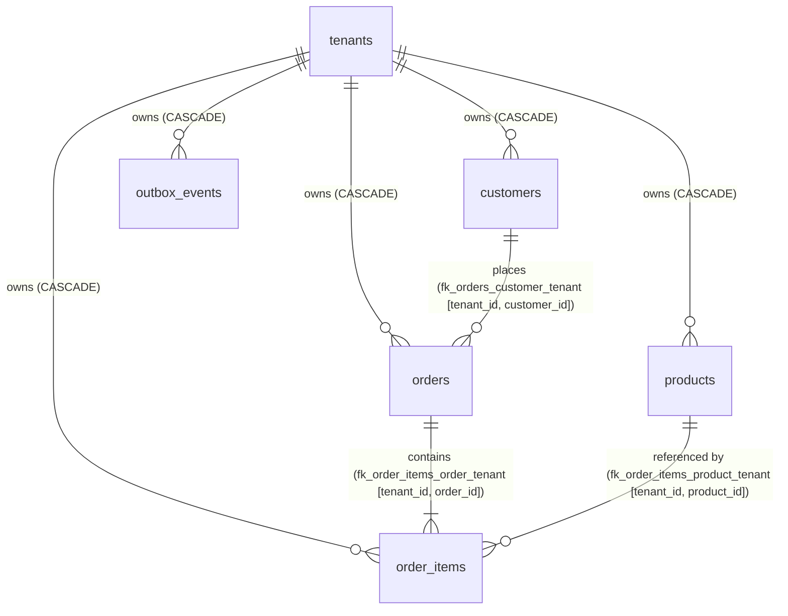

# AGGRIX Analytics SQL Design & Architectural Specification

## 1. Project Overview

AGGRIX is a multi-tenant analytics and aggregation engine engineered for Shopify-inspired e-commerce stores. The database layer is deployed on **PostgreSQL 16** and mapped through **SQLAlchemy 2.0** and **Alembic**, providing the data foundation for merchant dashboards, operational monitoring, and sales analytics.

This document establishes the official analytics SQL query design, business semantics, boundary conditions, index compatibility, and multi-currency reporting contracts for the **exact five assigned core metrics**:

1. **Total orders in the last 7 days**
2. **Total sales in the last 7 days**
3. **Orders per day over the last 30 days**
4. **Top 10 products by sales this week**
5. **Order counts grouped by order status**

---

## 2. Verified Schema Inventory

All entity definitions were inspected directly in `backend/app/models/` and validated against Alembic migration `alembic/versions/0001_initial_schema.py`.

| Table | Entity Class | Primary Key | Tenant Isolation Column | Data Columns | Verified Constraints & Indexes |
| :--- | :--- | :--- | :--- | :--- | :--- |
| `tenants` | `Tenant` | `id UUID` | N/A (Root entity) | `name VARCHAR(255)`, `domain VARCHAR(255)`, `created_at TIMESTAMPTZ`, `updated_at TIMESTAMPTZ` | `pk_tenants`, `uq_tenants_domain` |
| `customers` | `Customer` | `id UUID` | `tenant_id UUID NOT NULL` | `email VARCHAR(255)`, `name VARCHAR(255) NULL`, `created_at TIMESTAMPTZ`, `updated_at TIMESTAMPTZ` | `pk_customers`, `fk_customers_tenant_id`, `uq_customers_tenant_id_id`, `uq_customers_tenant_id_email`, `ix_customers_tenant_id`, `ix_customers_email` |
| `products` | `Product` | `id UUID` | `tenant_id UUID NOT NULL` | `name VARCHAR(255)`, `sku VARCHAR(100)`, `price NUMERIC(12,2)`, `currency VARCHAR(3)`, `created_at TIMESTAMPTZ`, `updated_at TIMESTAMPTZ` | `pk_products`, `ck_products_price_non_negative`, `fk_products_tenant_id`, `uq_products_tenant_id_id`, `uq_products_tenant_id_sku`, `ix_products_tenant_id`, `ix_products_sku` |
| `orders` | `Order` | `id UUID` | `tenant_id UUID NOT NULL` | `customer_id UUID NOT NULL`, `external_order_id VARCHAR(100)`, `total_amount NUMERIC(12,2)`, `currency VARCHAR(3)`, `status VARCHAR(50)`, `created_at TIMESTAMPTZ`, `updated_at TIMESTAMPTZ` | `pk_orders`, `ck_orders_total_amount_non_negative`, `fk_orders_tenant_id`, `fk_orders_customer_tenant`, `uq_orders_tenant_id_id`, `uq_orders_tenant_external_order_id`, `ix_orders_tenant_id`, `ix_orders_tenant_customer_id`, `ix_orders_tenant_status`, `ix_orders_tenant_created_at`, `ix_orders_tenant_status_created_at` |
| `order_items` | `OrderItem` | `id UUID` | `tenant_id UUID NOT NULL` | `order_id UUID NOT NULL`, `product_id UUID NOT NULL`, `quantity INTEGER NOT NULL`, `unit_price NUMERIC(12,2)`, `created_at TIMESTAMPTZ` | `pk_order_items`, `ck_order_items_quantity_positive`, `ck_order_items_unit_price_non_negative`, `fk_order_items_tenant_id`, `fk_order_items_order_tenant`, `fk_order_items_product_tenant`, `ix_order_items_tenant_id`, `ix_order_items_tenant_order_id`, `ix_order_items_tenant_product_id` |
| `outbox_events` | `OutboxEvent` | `id UUID` | `tenant_id UUID NOT NULL` | `event_type VARCHAR(100)`, `payload JSONB`, `created_at TIMESTAMPTZ`, `processed_at TIMESTAMPTZ NULL` | `pk_outbox_events`, `fk_outbox_events_tenant_id`, `ix_outbox_events_tenant_id`, `ix_outbox_events_unprocessed`, `ix_outbox_events_processed_at`, `ix_outbox_events_tenant_created` |

---

## 3. Table Relationships & Foreign Key Architecture

The schema implements a **Shared Database, Shared Schema with Tenant-Discriminator Column** architecture reinforced by database-level constraints:



### Critical Relational Invariants:
1. **Composite Foreign Keys**:
   - `orders (tenant_id, customer_id) -> customers (tenant_id, id)`: Ensures an order cannot link to a customer belonging to another tenant.
   - `order_items (tenant_id, order_id) -> orders (tenant_id, id)`: Enforces that order line items belong to the same tenant as the parent order.
   - `order_items (tenant_id, product_id) -> products (tenant_id, id)`: Enforces that purchased products belong to the same tenant.
2. **Price Independence**:
   - `Product.price` is the *current catalog listing price*. It is mutable.
   - `OrderItem.unit_price` is the *historical transaction unit price* captured at the time of purchase.
   - **Strict Analytics Rule**: Analytics **never** uses `products.price` for historical sales calculations. All revenue queries MUST aggregate `order_items.quantity * order_items.unit_price` or `orders.total_amount`.

---

## 4. Order Status Semantics & Business Classifications

The database column `orders.status` is defined as `VARCHAR(50)` with `server_default='pending'`. It is **not** an ENUM type and has no check constraint restricting permitted strings. The application docstring documents typical lifecycle values: `pending`, `paid`, `fulfilled`, `cancelled`.

### Business Category Classifications:

| Metric Category | Purpose | Included Statuses | Rationale |
| :--- | :--- | :--- | :--- |
| **A. Order Count (Volume)** | Measures gross operational demand and store traffic. | All placed orders (`pending`, `paid`, `fulfilled`, `cancelled`). | An order placed represents demand regardless of downstream payment or fulfillment outcome. A separate confirmed-only filter can be applied if required. |
| **B. Recognized Sales (Revenue)** | Measures realized financial turnover. | `paid`, `fulfilled` *(Provisional rule)*. | Excludes uncollected funds (`pending`) and voided transactions (`cancelled`). |
| **C. Product Sales (Merchandise)** | Measures physical units sold and line revenue. | Inherits parent order status: `paid`, `fulfilled`. | Prevents attributing product sales to aborted or cancelled transactions. |
| **D. Status Distribution (Pipeline)** | Operational dashboard of order processing states. | All distinct status values present in the database. | Provides merchant visibility into pipeline bottlenecks (e.g. high pending or cancelled counts). |

> [!IMPORTANT]
> The exclusion of `pending` and `cancelled` from recognized sales is a **provisional business rule** documented here for analytics consistency, requiring formal business sign-off before API implementation.

---

## 5. Exact Five Analytics Requirements

1. **Metric 1: Total Orders in the Last 7 Days**: Counts gross order volume placed by a tenant within an exact rolling 7-day half-open window.
2. **Metric 2: Total Sales in the Last 7 Days**: Sums `total_amount` for qualifying recognized orders in the last 7 rolling days, segmented strictly by currency.
3. **Metric 3: Orders Per Day Over the Last 30 Days**: Continuous calendar day breakdown generated via `generate_series()`, ensuring zero-order days are preserved and index compatibility is maintained.
4. **Metric 4: Top 10 Products by Sales This Week**: Ranks products by sales revenue and unit volume during the current calendar week, operating under a formal single-currency reporting contract.
5. **Metric 5: Order Counts Grouped by Order Status**: Aggregates orders across all active statuses for operational pipeline oversight.

---

## 6. One Correct SQL Query Per Metric

All queries are written for PostgreSQL 16 using standardized named parameters (`:tenant_id`, `:start_timestamp`, `:end_timestamp`, `:timezone`, `:currency`).

### Query 1: Total Orders in the Last 7 Days

```sql
-- Metric 1: Total Orders (Last 7 Rolling Days)
-- Parameters:
--   :tenant_id        UUID        Authenticated tenant ID
--   :start_timestamp  TIMESTAMPTZ Window start (e.g., T_ref - INTERVAL '7 days')
--   :end_timestamp    TIMESTAMPTZ Window end   (e.g., T_ref)

SELECT
    COUNT(id) AS total_orders
FROM orders
WHERE tenant_id = :tenant_id
  AND created_at >= :start_timestamp
  AND created_at < :end_timestamp;
```

---

### Query 2: Total Sales in the Last 7 Days

```sql
-- Metric 2: Total Sales (Last 7 Rolling Days)
-- Parameters:
--   :tenant_id        UUID        Authenticated tenant ID
--   :start_timestamp  TIMESTAMPTZ Window start (e.g., T_ref - INTERVAL '7 days')
--   :end_timestamp    TIMESTAMPTZ Window end   (e.g., T_ref)

SELECT
    currency,
    COUNT(id) AS qualifying_order_count,
    COALESCE(SUM(total_amount), 0.00) AS total_sales
FROM orders
WHERE tenant_id = :tenant_id
  AND status IN ('paid', 'fulfilled')
  AND created_at >= :start_timestamp
  AND created_at < :end_timestamp
GROUP BY currency
ORDER BY total_sales DESC;
```

---

### Query 3: Orders Per Day Over the Last 30 Days (Zero-Filled & Index-Compatible)

```sql
-- Metric 3: Orders Per Day (Last 30 Completed Calendar Days, Zero-Filled)
-- Parameters:
--   :tenant_id    UUID  Authenticated tenant ID
--   :start_date   DATE  Start date in reporting timezone (e.g., (CURRENT_DATE - INTERVAL '30 days')::DATE)
--   :end_date     DATE  End date in reporting timezone   (e.g., (CURRENT_DATE - INTERVAL '1 day')::DATE)
--   :timezone     TEXT  Merchant reporting timezone (e.g., 'America/New_York', 'UTC')

WITH calendar_series AS (
    SELECT generate_series(
        :start_date::date,
        :end_date::date,
        INTERVAL '1 day'
    )::date AS calendar_date
)
SELECT
    cs.calendar_date,
    COUNT(o.id) AS order_count
FROM calendar_series cs
LEFT JOIN orders o
    ON o.tenant_id = :tenant_id
   AND o.created_at >= (cs.calendar_date::timestamp AT TIME ZONE :timezone)
   AND o.created_at < ((cs.calendar_date + 1)::timestamp AT TIME ZONE :timezone)
GROUP BY cs.calendar_date
ORDER BY cs.calendar_date ASC;
```

---

### Query 4: Top 10 Products by Sales This Week

#### Recommended Primary Contract: Contract A (Single Store Currency Filter)
Filters explicitly by the tenant store's base reporting currency (`o.currency = :currency`). This guarantees that `LIMIT 10` returns **exactly 10 distinct products** and that all sales comparisons are economically valid without needing exchange-rate conversions.

```sql
-- Metric 4 (Contract A): Top 10 Products by Sales This Week (Scoped to Currency)
-- Parameters:
--   :tenant_id        UUID        Authenticated tenant ID
--   :currency         VARCHAR(3)  Target reporting currency (e.g., 'USD')
--   :start_timestamp  TIMESTAMPTZ Beginning of current calendar week in merchant timezone
--   :end_timestamp    TIMESTAMPTZ End boundary of current calendar week (or current time)

SELECT
    p.id AS product_id,
    p.name AS product_name,
    p.sku AS product_sku,
    o.currency AS transaction_currency,
    SUM(oi.quantity) AS units_sold,
    COALESCE(SUM(oi.quantity * oi.unit_price), 0.00) AS total_sales
FROM order_items oi
JOIN orders o
    ON oi.tenant_id = o.tenant_id
   AND oi.order_id = o.id
JOIN products p
    ON oi.tenant_id = p.tenant_id
   AND oi.product_id = p.id
WHERE oi.tenant_id = :tenant_id
  AND o.currency = :currency
  AND o.status IN ('paid', 'fulfilled')
  AND o.created_at >= :start_timestamp
  AND o.created_at < :end_timestamp
GROUP BY p.id, p.name, p.sku, o.currency
ORDER BY total_sales DESC, units_sold DESC
LIMIT 10;
```

#### Secondary Contract: Contract B (Global Unit Volume Ranking Across Currencies)
If the merchant sells in multiple currencies and wants to see top-performing products across all currencies without converting exchange rates, products are ranked by physical unit volume (`SUM(oi.quantity)`), which is dimensionally uniform across currencies:

```sql
-- Metric 4 (Contract B): Top 10 Products by Physical Unit Volume This Week
-- Parameters:
--   :tenant_id        UUID        Authenticated tenant ID
--   :start_timestamp  TIMESTAMPTZ Beginning of current calendar week in merchant timezone
--   :end_timestamp    TIMESTAMPTZ End boundary of current calendar week (or current time)

SELECT
    p.id AS product_id,
    p.name AS product_name,
    p.sku AS product_sku,
    SUM(oi.quantity) AS total_units_sold
FROM order_items oi
JOIN orders o
    ON oi.tenant_id = o.tenant_id
   AND oi.order_id = o.id
JOIN products p
    ON oi.tenant_id = p.tenant_id
   AND oi.product_id = p.id
WHERE oi.tenant_id = :tenant_id
  AND o.status IN ('paid', 'fulfilled')
  AND o.created_at >= :start_timestamp
  AND o.created_at < :end_timestamp
GROUP BY p.id, p.name, p.sku
ORDER BY total_units_sold DESC
LIMIT 10;
```

---

### Query 5: Order Counts Grouped by Order Status

```sql
-- Metric 5: Current Order Distribution by Status
-- Parameters:
--   :tenant_id  UUID  Authenticated tenant ID

SELECT
    status,
    COUNT(id) AS order_count
FROM orders
WHERE tenant_id = :tenant_id
GROUP BY status
ORDER BY order_count DESC;
```

*(Note: For a windowed status breakdown over specific intervals, append `AND created_at >= :start_timestamp AND created_at < :end_timestamp` to the WHERE clause).*

---

## 7. Query Explanations & Technical Deep Dive

1. **Query 1 (Total Orders)**: Executes a single-table index scan on `orders` filtering by `tenant_id` and half-open `created_at` timestamp. Counts gross demand events. Returns a single scalar row.
2. **Query 2 (Total Sales)**: Scans `orders` within the half-open window, filtering for recognized sales statuses (`paid`, `fulfilled`). Crucially groups by `currency` to prevent cross-currency summation. Uses `COALESCE` to guarantee `0.00` rather than `NULL` when zero orders match.
3. **Query 3 (Daily Orders)**: Uses `generate_series` in a Common Table Expression (CTE) to create the reference date sequence. Uses `LEFT JOIN` on `orders` with sargable boundary comparisons converted to UTC via `AT TIME ZONE :timezone`. `COUNT(o.id)` evaluates to `0` when no orders exist on a day, guaranteeing an unbroken 30-day time series.
4. **Query 4 (Top 10 Products & Currency Mechanics)**:
   - **The Product-Currency Combination Problem**: If a query groups by `p.id, p.name, p.sku, o.currency` without a currency filter, a single product sold in USD, CAD, and EUR generates 3 separate rows. Applying `LIMIT 10` on that result limits the output to **10 product-currency combinations**, which could represent as few as 4 or 5 unique products!
   - **Economic Incompatibility**: Ordering by `total_sales DESC` across unnormalized currencies compares raw nominal amounts (e.g. 10,000 JPY vs $1,000 USD), which is financially invalid without exchange rates.
   - **Resolution (Contract A)**: By filtering on `o.currency = :currency`, every row is strictly in that currency, ensuring that `p.id` is unique in the result and `LIMIT 10` returns **exactly 10 distinct products**.
5. **Query 5 (Status Counts)**: Directly aggregates the operational status pipeline for the tenant across all orders.

---

## 8. Tenant Isolation Architecture

- **Mandatory Tenant Predicate**: Every query enforces `tenant_id = :tenant_id`.
- **Join Boundary Enforcement**: All joins include explicit tenant consistency:
  - `oi.tenant_id = o.tenant_id AND oi.order_id = o.id`
  - `oi.tenant_id = p.tenant_id AND oi.product_id = p.id`
- **Application Context Security**: `:tenant_id` must be injected exclusively from verified server-side authentication (e.g. validated JWT token or session identity). It must never be accepted directly from untrusted client input.

---

## 9. Cancelled-Order Treatment

- **Order Volume (Metric 1 & Metric 3)**: Cancelled orders represent shopping intent and gross platform activity; they are included in default order counts unless a confirmed-only filter is selected.
- **Sales Revenue (Metric 2 & Metric 4)**: Cancelled orders are strictly **excluded** (`status NOT IN ('cancelled')` or explicit `status IN ('paid', 'fulfilled')`), because no economic exchange was realized.
- **Status Distribution (Metric 5)**: Cancelled orders are explicitly **included** as their own distinct category to monitor merchant cancellation rates.

---

## 10. Refund Limitations & Financial Impact

> [!WARNING]
> **Schema Limitation**: The existing database schema does **not** support refunds.
> - There is no `refunds` table.
> - There is no `refunded_amount` column on `orders`.
> - There are no refund line items or timestamps.

If an order is refunded in Shopify, the current schema has no financial record mechanism. Therefore:
- Analytics queries currently report **Gross Sales** (`total_amount`).
- Net sales (Gross Sales - Refunds) cannot be computed until a refund migration is introduced.

---

## 11. Timestamp Boundaries & Rolling Window Architecture

### 11.1 Application Reference Timestamp Calculation

To avoid clock drift and window boundary discrepancies, the application MUST calculate `start_timestamp` and `end_timestamp` using **one consistent reference timestamp** ($T_{\text{ref}}$) captured once at request ingress:

```python
# Application boundary calculation (Python 3.11+)
from datetime import datetime, timezone, timedelta

# Capture one immutable reference timestamp
T_ref = datetime.now(timezone.utc)

# Exact rolling 7 days: exactly 168 hours (604,800 seconds)
end_timestamp = T_ref
start_timestamp = T_ref - timedelta(days=7)
```

### 11.2 Mathematical Half-Open Interval Definition

All queries enforce **half-open timestamp intervals**:
$$\text{created\_at} \ge \text{start\_timestamp} \quad \text{AND} \quad \text{created\_at} < \text{end\_timestamp}$$
$$[\text{start\_timestamp}, \text{end\_timestamp})$$

#### Mathematical Properties:
1. **Zero Double-Counting**: If two consecutive periods $[T_0, T_1)$ and $[T_1, T_2)$ are queried, an order created at the exact microsecond $T_1$ falls exclusively into the second period. It is never double-counted.
2. **Zero Gaps**: No transaction can fall between adjacent periods.
3. **Flaw of Closed Intervals (`BETWEEN`)**: SQL `BETWEEN a AND b` is equivalent to $[a, b]$ (closed). In financial reporting, closed intervals double-count transactions occurring at boundary instants.

### 11.3 Architectural Comparison: Rolling 7 Days vs. 7 Calendar Days

| Dimension | Rolling 7 Days (Metrics 1 & 2) | 7 Calendar Days |
| :--- | :--- | :--- |
| **Window Boundary** | Continuous sliding window: $[T_{\text{ref}} - 168\text{h}, T_{\text{ref}})$ | Fixed midnight-to-midnight blocks in merchant timezone |
| **Duration** | Exactly $7 \times 24 = 168$ hours ($604,800$ seconds) | Variable if crossing Daylight Saving Time (167, 168, or 169 hours) |
| **Current Day Status** | Includes real-time activity up to the exact second of $T_{\text{ref}}$ | Excludes current incomplete day (reports completed days only) |
| **Timezone Sensitivity** | Completely timezone-independent in duration (168 UTC hours) | Highly timezone-dependent (merchant local midnight) |
| **Primary Use Case** | Operational pulse, real-time demand, merchant dashboard cards | Financial accounting, bank reconciliations, week-over-week trends |

### 11.4 Recommended Reporting Convention for Last 30 Calendar Days (Metric 3)

In standard e-commerce reporting (Shopify, Stripe, Google Analytics), "today" is an **incomplete, partial intraday period**. Plotting today's partial day against 29 complete days creates an artificial cliff in merchant visual dashboards.

#### Standard Recommendation: 30 Completed Calendar Days (Excluding Today)
- **Reporting Timezone**: Merchant's configured local timezone (`:timezone`, e.g., `'America/New_York'`).
- **Convention**: Exactly 30 completed, closed calendar days prior to today:
  $$\text{end\_date} = (\text{CURRENT\_DATE}_{\text{merchant}} - 1\text{ day})$$
  $$\text{start\_date} = (\text{CURRENT\_DATE}_{\text{merchant}} - 30\text{ days})$$
- **Total Days Returned**: Exactly $(\text{end\_date} - \text{start\_date}) + 1 = 30\text{ dates}$.
- **Application Parameter Derivation**:
  ```python
  # Derived in merchant timezone
  today_merchant = datetime.now(merchant_tz).date()
  end_date = today_merchant - timedelta(days=1)
  start_date = today_merchant - timedelta(days=30)
  ```

#### Alternative Convention: 30 Days (Including Today)
If merchant explicitly toggles "Include Today (Intraday)", the bounds shift to:
- `start_date = today_merchant - timedelta(days=29)`
- `end_date = today_merchant`
- The documentation and API response must flag the final date as `is_partial: true`.

---

## 12. Currency Handling & Multi-Currency Reporting Architecture

### 12.1 The Multi-Currency Limitation in Metric 4

In `0001_initial_schema.py`:
- `orders.currency` stores the transaction currency (`VARCHAR(3)`).
- `order_items` has no `currency` column; it inherits `orders.currency`.
- There is **no exchange rate conversion table** in the database.

When querying Top 10 products without filtering by currency:
```sql
-- FLAWED PATTERN:
GROUP BY p.id, p.name, p.sku, o.currency
ORDER BY total_sales DESC
LIMIT 10;
```
1. **Row Multiplication**: If Product A is sold in USD and EUR, it generates 2 rows. `LIMIT 10` returns **10 product-currency combinations**, not 10 distinct products.
2. **Economic Incomparability**: Sorting unnormalized currencies ($10,000 \text{ JPY} > 1,000 \text{ USD}$) creates a meaningless ranking. Adding different currencies without conversion rates violates fundamental financial accounting.

### 12.2 Formal Reporting Contracts for Metric 4

To resolve this limitation cleanly, AGGRIX defines two supported contracts:

- **Contract A (Recommended Primary)**: **Single Currency Filter (`:currency`)**
  - Requires the client/dashboard to supply the merchant's base currency (e.g., `'USD'`).
  - Filters `o.currency = :currency`.
  - Guarantees each product appears at most once in the aggregated result.
  - Guarantees `LIMIT 10` returns **ten distinct products**, sorted accurately by sales volume in that currency.
- **Contract B (Secondary)**: **Physical Unit Volume Ranking**
  - Aggregates `SUM(oi.quantity)` grouped only by `p.id, p.name, p.sku`.
  - Dimensionally sound across all currencies (1 shirt sold in Japan = 1 shirt sold in USA).
  - Guarantees `LIMIT 10` returns **ten distinct products** by volume.

---

## 13. Existing Index Coverage & Sargability Analysis

Only indexes currently present in `backend/app/models/` and migration `0001_initial_schema.py` are referenced:

| Index Name | Table & Columns | Analytical Query Acceleration |
| :--- | :--- | :--- |
| `ix_orders_tenant_created_at` | `orders (tenant_id, created_at)` | Accelerates Metric 1 (Total Orders) and Metric 3 (Daily Orders join). |
| `ix_orders_tenant_status_created_at` | `orders (tenant_id, status, created_at)` | Accelerates Metric 2 (Total Sales) when filtering by qualifying statuses and date range. |
| `ix_order_items_tenant_order_id` | `order_items (tenant_id, order_id)` | Accelerates join between `order_items` and `orders` in Metric 4. |
| `ix_order_items_tenant_product_id` | `order_items (tenant_id, product_id)` | Accelerates join between `order_items` and `products` in Metric 4. |

### Sargability of Query 3 with `ix_orders_tenant_created_at`

In SQL, a predicate is **sargable** (Search Argument Able) if the database engine can utilize an index range scan rather than evaluating a function on every row.

- **Non-Sargable Anti-Pattern**:
  ```sql
  -- AVOID: Function on indexed column disables B-tree index
  ON o.tenant_id = :tenant_id
 AND (o.created_at AT TIME ZONE :timezone)::date = cs.calendar_date
  ```
  Here, PostgreSQL must evaluate `(created_at AT TIME ZONE ...)::date` on every order row for the tenant, forcing a full partition scan.

- **Sargable Design Used in Query 3**:
  ```sql
  -- SARGABLE: o.created_at is unadorned
  ON o.tenant_id = :tenant_id
 AND o.created_at >= (cs.calendar_date::timestamp AT TIME ZONE :timezone)
 AND o.created_at < ((cs.calendar_date + 1)::timestamp AT TIME ZONE :timezone)
  ```
  Here, the right-hand expressions evaluate to fixed `TIMESTAMPTZ` constants for each of the 30 calendar days. PostgreSQL's optimizer executes 30 fast **Index Range Scans** on `ix_orders_tenant_created_at (tenant_id, created_at)`.

---

## 14. Performance Considerations

1. **Index Range Scans**: Metric 1, 2, and 3 use B-tree index range scans bounded by `tenant_id` and half-open timestamps.
2. **Composite Join Alignment**: Metric 4 leverages `ix_order_items_tenant_order_id` and `ix_order_items_tenant_product_id` for efficient hash or nested loop joins.
3. **Aggregation Scaling**: For high-volume stores with $>1,000,000$ order items, Metric 4 joins three tables. Aggregating on raw transactional tables will eventually require daily materialized rollups in future engine phases.

---

## 15. Edge Cases Addressed

1. **Zero Orders on a Calendar Day**: Addressed in Metric 3 using `generate_series` with `LEFT JOIN` and `COUNT(o.id)`. Returns `0` instead of dropping the date, ensuring exactly 30 rows.
2. **Null Revenue on Zero Matching Orders**: Addressed using `COALESCE(SUM(...), 0.00)` to prevent returning `NULL`.
3. **Product Renaming**: `order_items` stores only `product_id`. If a product is renamed, Metric 4 reflects current `products.name`. Documented as expected behavior in absence of line-item product name snapshots.
4. **Deleted Products**: Products referenced in historical orders are protected from deletion by `ON DELETE RESTRICT` on `fk_order_items_product_tenant`.

---

## 16. Sample Parameters and Illustrative Outputs

### Metric 1: Total Orders (Last 7 Days)
**Sample Parameters**:
- `:tenant_id`: `'d9200db8-b83e-4266-b45c-0286e3d880a1'`
- `:start_timestamp`: `'2026-10-24 15:30:00+00'`
- `:end_timestamp`: `'2026-10-31 15:30:00+00'`

**Illustrative Output**:
| total_orders |
| :--- |
| `142` |

---

### Metric 2: Total Sales (Last 7 Days)
**Sample Parameters**: Same 7-day interval.

**Illustrative Output**:
| currency | qualifying_order_count | total_sales |
| :--- | :--- | :--- |
| `USD` | `138` | `14850.50` |
| `CAD` | `4` | `412.00` |

---

### Metric 3: Orders Per Day (Last 30 Days)
**Sample Parameters**:
- `:tenant_id`: `'d9200db8-b83e-4266-b45c-0286e3d880a1'`
- `:start_date`: `'2026-10-01'`
- `:end_date`: `'2026-10-30'`
- `:timezone`: `'America/New_York'`

**Illustrative Output (Exactly 30 rows, zero-filled)**:
| calendar_date | order_count |
| :--- | :--- |
| `2026-10-01` | `18` |
| `2026-10-02` | `0` |
| `2026-10-03` | `24` |
| `...` | `...` |
| `2026-10-30` | `15` |

---

### Metric 4: Top 10 Products by Sales This Week (Contract A)
**Sample Parameters**:
- `:tenant_id`: `'d9200db8-b83e-4266-b45c-0286e3d880a1'`
- `:currency`: `'USD'`
- `:start_timestamp`: `'2026-10-26 04:00:00+00'` (Monday 00:00 EDT)
- `:end_timestamp`: `'2026-10-31 15:30:00+00'`

**Illustrative Output (Exactly 10 distinct products)**:
| product_id | product_name | product_sku | transaction_currency | units_sold | total_sales |
| :--- | :--- | :--- | :--- | :--- | :--- |
| `a1b2c3d4-...` | Wireless Noise-Cancelling Headphones | `WH-1000XM5` | `USD` | `35` | `12246.50` |
| `e5f6a7b8-...` | Espresso Machine Classic | `ESP-500` | `USD` | `12` | `7188.00` |
| `c9d0e1f2-...` | Ergonomic Mechanical Keyboard | `KB-MECH-01` | `USD` | `42` | `4158.00` |
| `...` | `...` | `...` | `USD` | `...` | `...` |

---

### Metric 5: Order Counts Grouped by Status
**Sample Parameters**:
- `:tenant_id`: `'d9200db8-b83e-4266-b45c-0286e3d880a1'`

**Illustrative Output**:
| status | order_count |
| :--- | :--- |
| `fulfilled` | `854` |
| `paid` | `42` |
| `pending` | `11` |
| `cancelled` | `9` |

---

## 17. Known Limitations

1. **No Refund Accounting**: Schema lacks refund tables; sales represent gross transaction values.
2. **No Fee / Tax / Shipping Breakdown**: `orders.total_amount` is an unitemized total.
3. **No Line Item Name History**: Product renames reflect retroactively on past order reports.
4. **No Status Timestamp History**: The timestamp when an order changed from `pending` to `paid` or `cancelled` is not recorded.
5. **No Multi-Currency Normalization**: AGGRIX cannot combine sales across different currencies into a single total until an exchange rate table is added.

---

## 18. Business Decisions Requiring Team Approval

1. **Revenue Recognition Policy**: Formal confirmation that `status IN ('paid', 'fulfilled')` defines recognized sales.
2. **Gross vs. Confirmed Order Counts**: Agreement that Metric 1 reports gross order placements by default.
3. **Top Products Multi-Currency Policy**: Approval of Contract A (single base currency filtering) as the default product sales reporting behavior.
4. **Reporting Convention for Daily Series**: Confirmation that the last 30 calendar days excludes today by default to prevent partial-day chart distortion.

---

## 19. Integration Notes for Future Analytics Engine

1. **Parameter Binding in FastAPI / SQLAlchemy**:
   ```python
   result = await session.execute(
       text(DAILY_ORDERS_QUERY),
       {
           "tenant_id": current_tenant.id,
           "start_date": start_date,
           "end_date": end_date,
           "timezone": current_tenant.timezone or "UTC"
       }
   )
   ```
2. **Read-Only Transactions**: Analytics queries should execute with `READ ONLY` transaction isolation (`SET TRANSACTION READ ONLY`) to prevent accidental lock contention on production OLTP tables.
3. **Materialized Aggregation Pathway**: When tenant data grows beyond $100,000$ orders, these 5 SQL patterns should serve as the extract queries for scheduled rollup tables.
