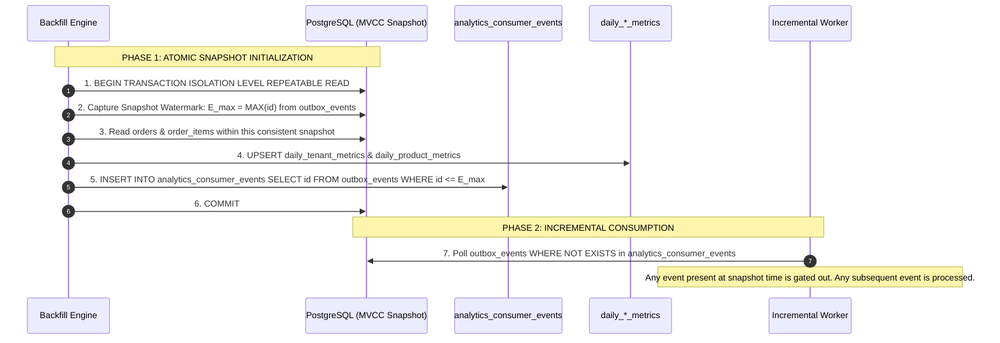
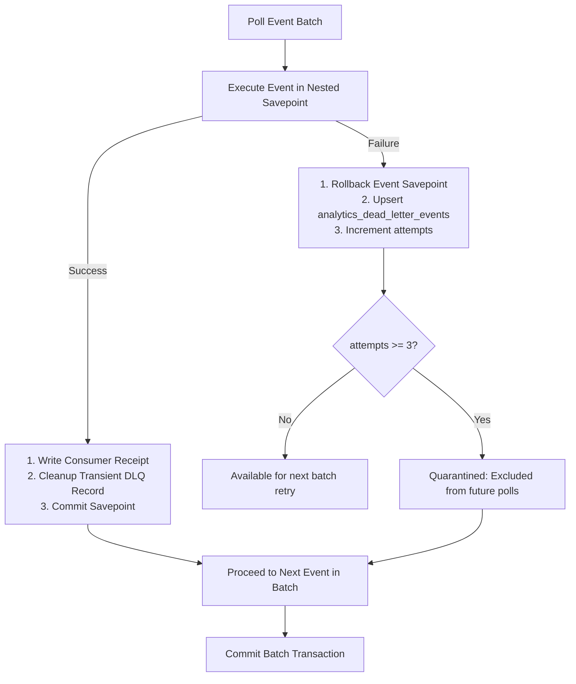

# AGGRIX Aggregation Worker: Corrected Architecture & Implementation Blueprint

---

## 1. Backfill Concurrency & Snapshot Synchronization

### The Boundary Failure Mode of Simple Timestamp Cutoffs
A simple timestamp cutoff (`WHERE created_at <= T_cutoff`) fails when an order placed **before** $T_{\text{cutoff}}$ transitions to a new state (e.g., `paid` or `cancelled`) **after** $T_{\text{cutoff}}$:

```
Timeline:
10:00 AM  Order #101 created (status='pending')
11:00 AM  === Naive Cutoff T_cutoff ===
11:05 AM  Order #101 payment captured (emits order.paid event)
11:15 AM  Backfill executes: aggregates orders WHERE created_at <= 11:00 AM
```

* If the backfill query reads `orders` at 11:15 AM, Order #101 is already `status = 'paid'`. The backfill aggregates it as recognized `net_sales`.
* If the incremental worker subsequently polls events created after 11:00 AM, it consumes the `order.paid` event from 11:05 AM and increments `net_sales` a second time, causing **revenue double-counting**.
* Conversely, if Order #101 was cancelled at 11:05 AM and the worker skips it because the order was placed before 11:00 AM, the cancellation is lost, causing **revenue overstatement**.

---

### The Solution: Consistent MVCC Snapshot & Event-ID Watermark Boundary

To ensure deterministic, atomic synchronization between the batch backfill and the incremental worker, we coordinate using a **PostgreSQL `REPEATABLE READ` snapshot** paired with an **Event-ID Watermark Gate**.



#### Protocol Guarantees:
1. **Single Consistent View**: Inside a `REPEATABLE READ` transaction, PostgreSQL guarantees that the state of `orders`, `order_items`, and `outbox_events` are locked to the exact same logical point in time.
2. **No Gap / No Overlap**: Every order state reflected in `daily_*_metrics` corresponds exactly to events up to `E_max`.
3. **Subsequent State Transitions**:
   * If Order #101 was `pending` at `E_max`: The backfill aggregated it as `pending`. Its `order.created` event was marked consumed.
   * When Order #101 transitions to `paid` after `E_max`, its `order.paid` event has `id > E_max`. The incremental worker detects it is not in `analytics_consumer_events`, processes the state transition, and increments `net_sales`.

---

## 2. Reconciling Pending Metrics & Schema Design

### Problem Statement
In the existing migrated schema (revision `9d95801676e5`):
* `daily_tenant_metrics` contains only: `orders_count`, `gross_sales`, `net_sales`, `cancelled_orders_count`, `cancelled_sales`.
* It **does not** contain `pending_orders_count` or `pending_sales`.
* In `docs/analytics-sql-design.md`, Category B states: *"Recognized Sales (Revenue): `paid`, `fulfilled`. Excludes `pending` and `cancelled`."*

If `net_sales` represents recognized revenue (`paid + fulfilled`), then whenever orders remain in `pending`, the equation $\text{gross\_sales} = \text{net\_sales} + \text{cancelled\_sales}$ **does not balance** because `pending_sales` is unaccounted for:
$$\text{gross\_sales} - \text{net\_sales} - \text{cancelled\_sales} = \mathbf{pending\_sales} \ne 0$$

---

### Architectural Recommendation: Explicit Schema Enhancement

Add explicit pending metric columns to both summary tables via an additive Alembic migration. This closes the accounting identity and provides exact pipeline visibility without querying raw transactional tables.

#### Table: `daily_tenant_metrics` (Additions)
* `pending_orders_count INTEGER NOT NULL DEFAULT 0`
* `pending_sales NUMERIC(14, 2) NOT NULL DEFAULT 0.00`
* Constraints:
  * `CONSTRAINT ck_daily_tenant_metrics_pending_orders_non_negative CHECK (pending_orders_count >= 0)`
  * `CONSTRAINT ck_daily_tenant_metrics_pending_sales_non_negative CHECK (pending_sales >= 0)`

#### Table: `daily_product_metrics` (Additions)
* `pending_units INTEGER NOT NULL DEFAULT 0`
* `pending_sales NUMERIC(14, 2) NOT NULL DEFAULT 0.00`
* Constraints:
  * `CONSTRAINT ck_daily_product_metrics_pending_units_non_negative CHECK (pending_units >= 0)`
  * `CONSTRAINT ck_daily_product_metrics_pending_sales_non_negative CHECK (pending_sales >= 0)`

---

### Complete Accounting Lifecycle Identity

With these fields added, the financial equation holds true at all times:
$$\mathbf{gross\_sales = net\_sales + pending\_sales + cancelled\_sales}$$
$$\mathbf{orders\_count = net\_orders\_count + pending\_orders\_count + cancelled\_orders\_count}$$

#### Exact Transition Updates Matrix:

| Event & Lifecycle Transition | `orders_count` | `gross_sales` | `pending_sales` | `net_sales` | `cancelled_sales` |
| :--- | :---: | :---: | :---: | :---: | :---: |
| **1. Order Created** (`null -> pending`) | **$+1$** | **$+\text{Total}$** | **$+\text{Total}$** | $0.00$ | $0.00$ |
| **2. Order Paid** (`pending -> paid`) | $0$ | $0.00$ | **$-\text{Total}$** | **$+\text{Total}$** | $0.00$ |
| **3. Order Fulfilled** (`paid -> fulfilled`) | $0$ | $0.00$ | $0.00$ | $0.00$ | $0.00$ |
| **4. Pending Cancelled** (`pending -> cancelled`) | $0$ | $0.00$ | **$-\text{Total}$** | $0.00$ | **$+\text{Total}$** |
| **5. Paid Cancelled / Refunded** (`paid -> cancelled`) | $0$ | $0.00$ | $0.00$ | **$-\text{Total}$** | **$+\text{Total}$** |

---

## 3. Explicit Tenant Timezone Configuration

### Why Timezone Cannot Be Inferred
1. **Currency Is Not Geography**: A merchant selling in `USD` may operate in London (`Europe/London`), New York (`America/New_York`), or Tokyo (`Asia/Tokyo`).
2. **Domain Names Lack Timezone Metadata**: Synthetic domains like `nordic-living-goods.synthetic.aggrix.test` are not valid IANA timezones and cause PostgreSQL exceptions when evaluated in `AT TIME ZONE`.

---

### Explicit Timezone Schema Addition

Add an explicit `timezone` column to `backend/app/models/tenant.py`:

```sql
ALTER TABLE tenants 
ADD COLUMN timezone VARCHAR(50) NOT NULL DEFAULT 'UTC';
```

#### Documented Fallback:
If `timezone` is NULL or unconfigured during dynamic runtime execution, the engine defaults to **`UTC`**:
```sql
DATE(o.created_at AT TIME ZONE COALESCE(t.timezone, 'UTC')) AS metric_date
```

#### Synthetic Tenants Initial Configuration:
For the 5 existing synthetic merchants in `aggrix_db`, seed explicit, documented IANA timezones:
* `nordic-living-goods` $\rightarrow$ `'Europe/Stockholm'`
* `velvet-vine-apparel` $\rightarrow$ `'Europe/London'`
* `aura-athletics` $\rightarrow$ `'America/New_York'`
* `apex-tech-lab` $\rightarrow$ `'America/Los_Angeles'`
* `urban-botanica` $\rightarrow$ `'Asia/Kolkata'`

---

## 4. Event Ordering & Causal Concurrency Guarantees

### The Hazard of `SKIP LOCKED` Across Multiple Workers
If multiple worker instances poll using `FOR UPDATE SKIP LOCKED`:
* Worker A claims `order.created` (Event #1).
* Worker B concurrently claims `order.paid` (Event #2) for the **same order**.
* If Worker B commits before Worker A, `order.paid` executes on a non-existent summary row or attempts to transition an order before it has been created, corrupting causal lifecycle invariants.

---

### Safe Initial Single-Worker Architecture (Phase 1)

For the current scale (10,000 orders, single PostgreSQL database), a **Single-Worker Leader Model** coordinates with the backfill service via PostgreSQL transaction-scoped advisory locks:

```sql
-- Single-Worker Causal Poll Query with Whitelisted Event Filtering
SELECT oe.id, oe.tenant_id, oe.event_type, oe.payload, oe.created_at
FROM outbox_events oe
WHERE oe.event_type IN ('order.created', 'order.paid', 'order.fulfilled', 'order.cancelled')
  AND oe.payload->>'order_id' IS NOT NULL
  AND NOT EXISTS (
      SELECT 1 
      FROM analytics_consumer_events ace
      WHERE ace.consumer_name = 'analytics_worker'
        AND ace.event_id = oe.id
  )
ORDER BY oe.created_at ASC, oe.id ASC
LIMIT 100
FOR UPDATE OF oe SKIP LOCKED;
```

#### Shared Advisory Lock Coordination (`AGGRIX_ANALYTICS_LOCK_ID = 849204918239102`):
To prevent race conditions, lost updates, or serialization failures between batch backfills and the incremental worker:
1. **Lock Mechanism**: Uses PostgreSQL `pg_advisory_xact_lock(:lock_id)` at the start of each worker batch or backfill transaction.
2. **Lock Lifecycle**: The lock is tied to the active transaction. It is automatically released by PostgreSQL on `COMMIT` or `ROLLBACK`. If a worker dies, PostgreSQL cleans up the lock immediately with zero leak risk.
3. **Mutual Exclusion**: If a backfill is running, the incremental worker cannot modify summary tables; if a worker is processing a batch, backfill safely waits (or fails fast if `--no-wait-lock` is specified).

#### Causal Ordering & Non-Monotonicity Guarantees:
1. **UUIDv4 Non-Monotonicity**: UUIDs are randomly generated and do not guarantee creation order or commit order. `ORDER BY oe.id ASC` is strictly a deterministic tie-breaker.
2. **Transaction Commit Races**: If Transaction A starts earlier than Transaction B but commits later, Event B becomes visible before Event A.
3. **Defensive State Handlers**: Worker event handlers must verify current order state and `event.payload['previous_status']` rather than assuming predecessor events were processed in the same batch.
4. **Consumer Receipt Schema Integrity**: `analytics_consumer_events.order_id` is strictly `nullable=False` because `analytics_worker` is an order-only consumer, enforcing database integrity.

---

### Future Multi-Worker Strategy: Tenant-Partitioned Sharding (Phase 2)

When scaling to 100+ tenants and millions of events, events for different tenants are mathematically independent. Cross-order causality exists **only within the same tenant**.

```mermaid
flowchart TD
    Outbox[outbox_events Table] --> Dispatcher[Partitioned Worker Fleet]
    
    subgraph "Parallel Worker Shards"
        W0[Worker 0: WHERE mod(hashtext(tenant_id), 4) = 0]
        W1[Worker 1: WHERE mod(hashtext(tenant_id), 4) = 1]
        W2[Worker 2: WHERE mod(hashtext(tenant_id), 4) = 2]
        W3[Worker 3: WHERE mod(hashtext(tenant_id), 4) = 3]
    end

    Dispatcher --> W0
    Dispatcher --> W1
    Dispatcher --> W2
    Dispatcher --> W3

    W0 --> Store0[Tenant A & E Summaries]
    W1 --> Store1[Tenant B Summaries]
    W2 --> Store2[Tenant C Summaries]
    W3 --> Store3[Tenant D Summaries]
```

```sql
-- Worker shard i of N:
SELECT oe.id, oe.tenant_id, oe.event_type, oe.payload, oe.created_at
FROM outbox_events oe
WHERE ('x' || substr(md5(oe.tenant_id::text), 1, 8))::bit(32)::int % :num_workers = :worker_id
  AND NOT EXISTS (
      SELECT 1 FROM analytics_consumer_events ace 
      WHERE ace.consumer_name = 'analytics_worker' AND ace.event_id = oe.id
  )
ORDER BY oe.created_at ASC, oe.id ASC
LIMIT 100
FOR UPDATE OF oe SKIP LOCKED;
```
* **Guarantee**: All events for any single tenant are processed sequentially by exactly one worker shard. No cross-worker ordering collision is possible.

---

## 5. Currency Segregation Invariant

The current PostgreSQL database contains 10,000 orders in **`USD`**, while the aggregation schema defaults to **`INR`**.

### Strict Architectural Invariants:
1. **Never Mix Currencies**: `gross_sales` or `net_sales` must never combine amounts from different currency codes.
2. **Composite Partitioning**:
   * `daily_tenant_metrics` primary key/unique: `(tenant_id, metric_date, currency)`
   * `daily_product_metrics` primary key/unique: `(tenant_id, product_id, metric_date, currency)`
3. **No Automatic FX Conversion**:
   * All aggregations explicitly evaluate `GROUP BY o.currency`.
   * Existing 10,000 synthetic records are stored and aggregated under `currency = 'USD'`.
   * Future Indian stores are stored and aggregated under `currency = 'INR'`.
   * API endpoints must either filter by `WHERE currency = :currency` or return a multi-currency response array (`[{"currency": "USD", ...}, {"currency": "INR", ...}]`).

---

## 6. Corrected Architecture & Transaction Boundaries

```mermaid
flowchart TD
    subgraph "Atomic Worker Transaction"
        Begin[1. BEGIN TRANSACTION]
        Poll[2. SELECT ... FOR UPDATE SKIP LOCKED]
        Dedup[3. INSERT INTO analytics_consumer_events ... ON CONFLICT DO NOTHING]
        
        subgraph "Handler Execution"
            Created[order.created: +gross, +pending]
            Paid[order.paid: -pending, +net]
            CancelPending[order.cancelled (from pending): -pending, +cancelled]
            CancelPaid[order.cancelled (from paid): -net, +cancelled]
        end

        Apply[4. Apply Daily Metric Updates via UPSERT]
        Commit[5. COMMIT]
    end

    Begin --> Poll --> Dedup --> Created & Paid & CancelPending & CancelPaid --> Apply --> Commit
```

### Failure Recovery & Poison-Pill Handling:
* **Crash Resilience**: If a process terminates during execution, PostgreSQL rolls back the nested transaction, releases the advisory/row locks, and leaves both `analytics_consumer_events` and summary tables unmutated.
* **Dead-Letter Queue (DLQ)**: If an individual event raises an unhandled exception (e.g., corrupted JSONB payload), it is retried with exponential backoff up to 3 times. Upon reaching max retries, the error is written to `analytics_dead_letter_events` and the worker advances, preventing head-of-line blocking.

---

## 7. Concrete Verification Tests

The following tests will be implemented in `tests/test_analytics_worker.py`:

1. **Backfill Snapshot Consistency Test**:
   * Create an order before snapshot cutoff.
   * Transition order to `paid` after snapshot cutoff.
   * Run backfill followed by incremental worker.
   * Assert `net_sales` reflects the order exactly once (no double-counting).
2. **Pending-to-Paid Lifecycle Test**:
   * Ingest `order.created`: assert `pending_sales == total_amount` and `net_sales == 0.00`.
   * Ingest `order.paid`: assert `pending_sales == 0.00` and `net_sales == total_amount`.
3. **Pending-to-Cancelled Lifecycle Test**:
   * Ingest `order.created`: assert `pending_sales == total_amount`.
   * Ingest `order.cancelled`: assert `pending_sales == 0.00`, `cancelled_sales == total_amount`, and `net_sales == 0.00`.
4. **Paid-to-Cancelled (Refund) Lifecycle Test**:
   * Ingest `order.created` then `order.paid`: assert `net_sales == total_amount`.
   * Ingest `order.cancelled`: assert `net_sales == 0.00` and `cancelled_sales == total_amount`.
5. **Idempotent Replay Test**:
   * Deliver the same `order.paid` event 10 consecutive times.
   * Assert `net_sales` increments exactly once and `analytics_consumer_events` contains 1 record.
6. **Timezone Day-Bucket Test**:
   * Create an order at `2026-10-05 20:30:00 UTC` for a tenant with `timezone = 'Asia/Kolkata'`.
   * Assert summary metric row is created under `metric_date = '2026-10-06'`.
7. **Multi-Currency Isolation Test**:
   * Insert USD and INR orders on the same calendar day for the same tenant.
   * Assert two distinct rows exist with identical `tenant_id` and `metric_date` but segregated `currency` columns.

---

## 8. Stage 2 Implementation & Operational Guide: Live Background Daemon & Dead-Letter Handling

### 8.1 Configuration & Environment Settings

The worker daemon behavior is fully configurable via `.env` or system environment variables:

| Setting Key | Environment Variable | Default | Description |
| :--- | :--- | :--- | :--- |
| `ANALYTICS_WORKER_POLL_INTERVAL_SECONDS` | `ANALYTICS_WORKER_POLL_INTERVAL_SECONDS` | `1.0` | Polling sleep interval in seconds when the outbox queue is empty. |
| `ANALYTICS_WORKER_BATCH_SIZE` | `ANALYTICS_WORKER_BATCH_SIZE` | `100` | Number of outbox events processed in each batch transaction. |
| `ANALYTICS_WORKER_MAX_RETRIES` | `ANALYTICS_WORKER_MAX_RETRIES` | `3` | Maximum processing attempts before an event is permanently quarantined in DLQ. |
| `ANALYTICS_WORKER_CONSUMER_NAME` | `ANALYTICS_WORKER_CONSUMER_NAME` | `analytics_worker` | Consumer tracking identifier for receipts and dead letters. |

---

### 8.2 Operational Guide: Starting & Stopping the Worker Daemon

#### A. Starting the Daemon via CLI
Ensure virtualenv is activated and `PYTHONPATH=backend`:
```bash
# Run foreground daemon
PYTHONPATH=backend python -m app.analytics.worker

# Run with custom parameters
PYTHONPATH=backend python -c "
from app.analytics.worker import run_worker_daemon
run_worker_daemon(batch_size=250, poll_interval_seconds=0.5, max_retries=3)
"
```

#### B. Stopping the Daemon Gracefully
The daemon traps `SIGINT` (Ctrl+C) and `SIGTERM` signals:
```bash
# Graceful stop via process signal
kill -15 <worker_pid>

# Or if running under Docker
docker stop --time 10 aggrix-worker
```
* **Shutdown Safety Guarantee**: When a termination signal is received, the daemon does not abort mid-flight. If a batch transaction is active, it completes all database writes and commits cleanly. The sleep loop unblocks immediately upon signal receipt to prevent unnecessary delay.

---

### 8.3 Dead-Letter Queue Architecture (`analytics_dead_letter_events`)



1. **Per-Event Savepoint Isolation (`begin_nested()`)**:
   - Each event in the batch executes inside a savepoint. If an event encounters corrupted payload data or a calculation violation, only that event's savepoint rolls back.
   - Valid events in the same batch proceed and commit atomically. A single poison-pill event cannot hold the rest of the queue hostage.
2. **Retry Progression & Quarantine**:
   - Failed events increment `attempts` in `analytics_dead_letter_events`.
   - On the next polling cycle, the event is retried.
   - Once `attempts >= ANALYTICS_WORKER_MAX_RETRIES` (default `3`), the polling query excludes it via:
     ```sql
     AND NOT EXISTS (
         SELECT 1 FROM analytics_dead_letter_events dle
         WHERE dle.consumer_name = :consumer_name
           AND dle.event_id = oe.id
           AND dle.attempts >= :max_retries
     )
     ```
3. **Transient Error Recovery**:
   - If an event fails once due to a transient timeout and succeeds on attempt 2, `_cleanup_dead_letter_on_success` deletes the transient failure record so the dead-letter queue contains only unrecovered failures.

---

### 8.4 Product-Level Aggregation & Multi-Item Safeguards

* **Multi-Item Accumulation**: When an order contains multiple line items for the same `product_id`, quantities and gross/net/cancelled sales are summed without overwriting.
* **Order Count Invariant**: `orders_count` in `daily_product_metrics` increments by 1 per unique product per order, regardless of line item splits.
* **Out-of-Order Lifecycle**: Product metrics maintain exact parity with tenant-level metrics during inverted delivery (`order.paid` before `order.created`, or `order.cancelled` before `order.created`), guaranteeing that:
  $$\mathbf{units\_sold\_gross = units\_sold\_net + pending\_units + cancelled\_units}$$
  $$\mathbf{gross\_sales = net\_sales + pending\_sales + cancelled\_sales}$$

