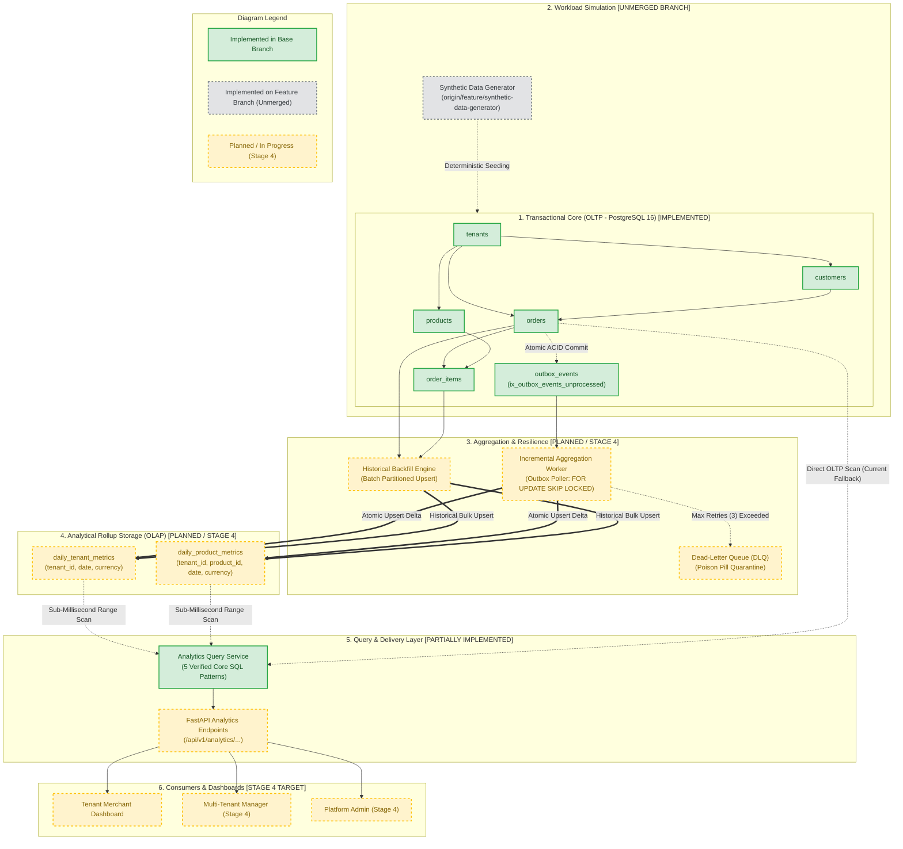
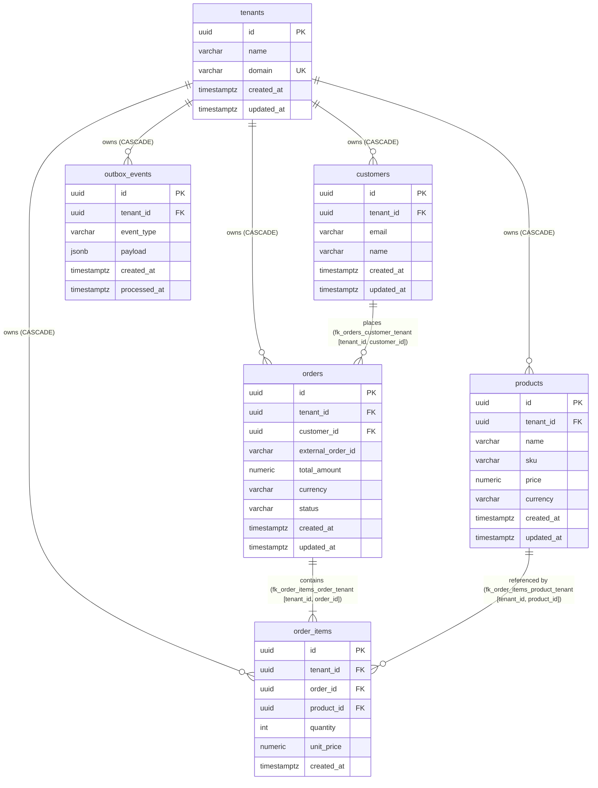
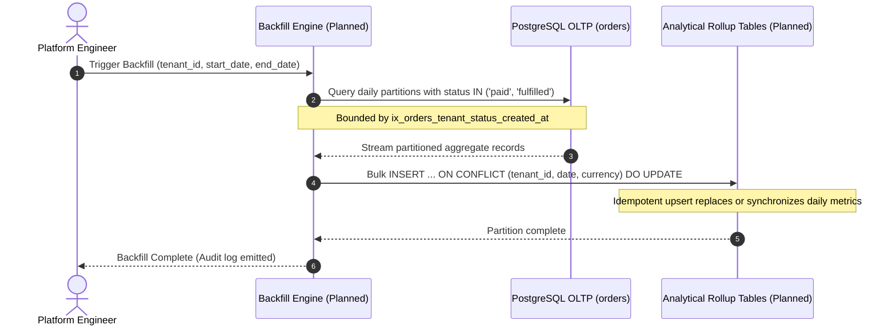
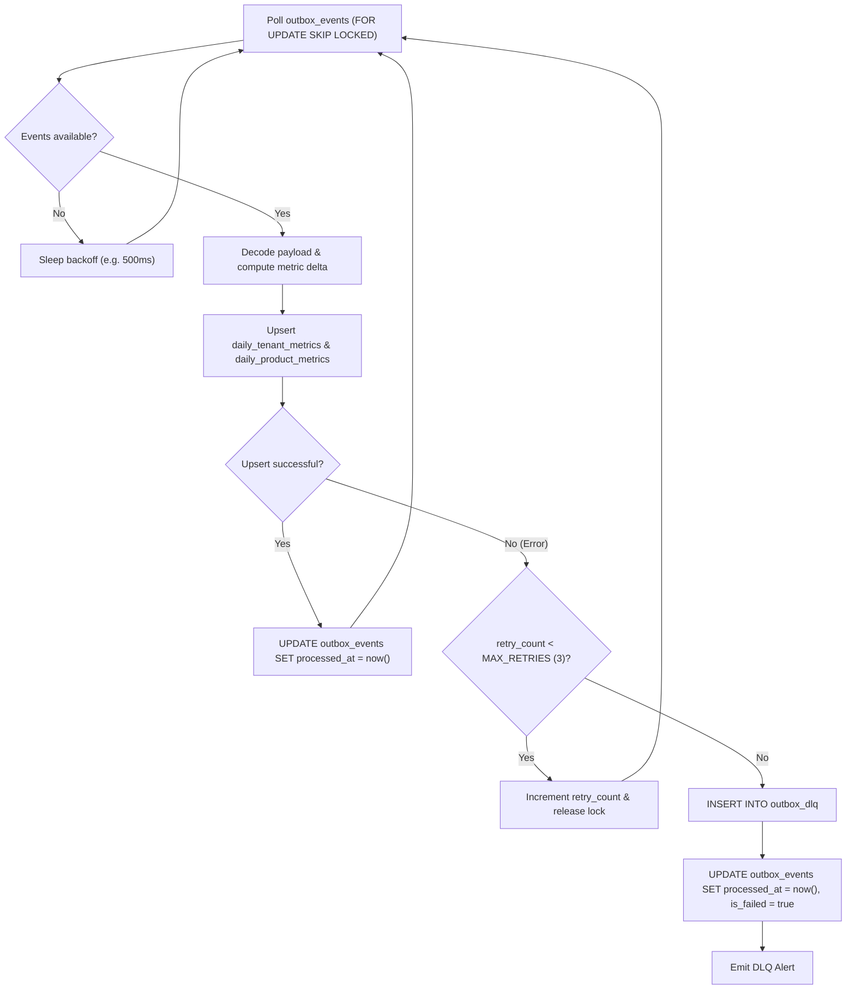
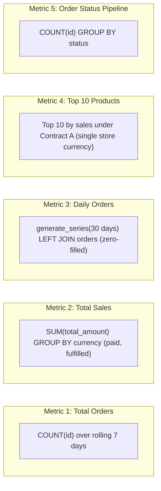

# AGGRIX — System Architecture Specification
## Multi-Tenant Analytics & Aggregation Engine

---

## 1. Executive Summary & Architectural Reality

**AGGRIX** is an enterprise-grade multi-tenant analytics and aggregation engine engineered for Shopify-inspired e-commerce platforms. The engine enables online store merchants to monitor operational store traffic, sales velocity, product merchandise performance, and order lifecycle states with low latency, strict multi-tenant isolation, and complete currency integrity.

This document establishes the official architectural blueprint across the transactional OLTP storage layer, the Transactional Outbox event pipeline, synthetic workload generation, historical aggregation backfilling, the streaming aggregation worker, pre-aggregated rollup models, and the FastAPI analytical query service.

> [!IMPORTANT]
> **Implementation Reality & Scope Clarification**:
> - **Implemented in Active Repository**: The 6 core PostgreSQL source tables, composite foreign keys, transactional outbox table with partial indexing, FastAPI application skeleton (`/health`), and the 5 core analytics SQL queries.
> - **Implemented on Separate Feature Branch**: The Synthetic Data Generator lives on `origin/feature/synthetic-data-generator` (pending merge into integration branch).
> - **Planned / In Progress (Stage 4 Target)**: The background aggregation worker daemon, Dead-Letter Queue (DLQ), pre-aggregated daily rollup tables (`daily_tenant_metrics`, `daily_product_metrics`), and the `/api/v1/analytics/*` route handlers.

---

## 2. End-to-End System Architecture Diagram



---

## 3. Component Status & Reality Ledger

| # | System Component | Architectural Status | Actual Codebase Evidence & Location |
| :-: | :--- | :---: | :--- |
| **1** | **PostgreSQL Source Tables** | **Implemented** | `backend/app/models/` (`tenant.py`, `customer.py`, `product.py`, `order.py`, `order_item.py`), `alembic/versions/0001_initial_schema.py`. Validated by 29 unit tests. |
| **2** | **Transactional Outbox** | **Implemented** | `backend/app/models/outbox_event.py`, migration `0001_initial_schema.py`. Partial index `ix_outbox_events_unprocessed` verified in DDL. |
| **3** | **Synthetic Data Generator** | **Implemented (Unmerged Branch)** | Commit `45c4f5a` on `origin/feature/synthetic-data-generator` (`backend/app/generator/` and `tests/test_generator.py`). Not yet merged into `feature/backend-setup`. |
| **4** | **Historical Backfill Engine** | **Planned / Specification Ready** | Backfill partition upsert SQL designed in documentation; automated CLI command / script is pending implementation. |
| **5** | **Incremental Aggregation Worker** | **Planned / In Progress** | Polling protocol (`FOR UPDATE SKIP LOCKED`) architected; background daemon process is pending implementation. |
| **6** | **Dead-Letter Queue (DLQ)** | **Planned / In Progress** | Fault isolation specification designed; `outbox_dlq` table and retry handler are pending implementation. |
| **7** | **Daily Tenant Metrics** | **Planned / Schema Ready** | Target DDL and composite unique constraint designed; not currently in `alembic/versions/`. In the interim, Metric queries run directly against indexed `orders`. |
| **8** | **Daily Product Metrics** | **Planned / Schema Ready** | Target DDL designed; not currently in `alembic/versions/`. In the interim, Metric 4 runs directly against indexed `order_items` and `products`. |
| **9** | **Analytics Query Service** | **Implemented (SQL Layer)** | `docs/analytics-sql-design.md`. All 5 SQL queries statically compiled and syntax-verified via SQLAlchemy 2.0 `text()`. |
| **10** | **FastAPI Analytics Endpoints** | **Planned / Stage 4 Target** | `backend/app/main.py` currently registers `/health` and `/api/v1/health`. Route handlers in `/api/v1/analytics/*` are scheduled for Stage 4. |

---

## 4. PostgreSQL Source Tables (OLTP Layer)

The source transactional database employs a **Shared Database, Shared Schema with Discriminator Column (`tenant_id`)** strategy, reinforced by composite database-level foreign keys.



### 4.1 Relational Invariants & Tenant Boundary Guarantees

1. **Composite Foreign Key Hardening**:
   - `orders (tenant_id, customer_id) -> customers (tenant_id, id)`
   - `order_items (tenant_id, order_id) -> orders (tenant_id, id)`
   - `order_items (tenant_id, product_id) -> products (tenant_id, id)`
   *Impact*: It is physically rejected by PostgreSQL to link an order from Tenant A to a customer or product from Tenant B.
2. **Historical Price Decoupling**:
   - `products.price` is mutable (current catalog price).
   - `order_items.unit_price` is an immutable financial snapshot captured at the exact second of purchase.
   *Impact*: Analytical queries never reference `products.price` for historical turnover calculations.
3. **B-Tree Index Coverage**:
   - `ix_orders_tenant_created_at (tenant_id, created_at)`: Directly serves Metric 1 (Total Orders) and Metric 3 (Daily Orders join).
   - `ix_orders_tenant_status_created_at (tenant_id, status, created_at)`: Directly serves Metric 2 (Total Sales).
   - `ix_order_items_tenant_order_id (tenant_id, order_id)` & `ix_order_items_tenant_product_id (tenant_id, product_id)`: Accelerates composite join alignment in Metric 4.

---

## 5. Transactional Outbox Pattern

To eliminate dual-write anomalies between relational updates and downstream asynchronous aggregators, AGGRIX utilizes the **Transactional Outbox Pattern**.

### 5.1 Outbox Schema & Partial Indexing
The `outbox_events` table is committed within the exact same PostgreSQL transaction that records business entities:

```sql
CREATE TABLE outbox_events (
    id UUID PRIMARY KEY DEFAULT gen_random_uuid(),
    tenant_id UUID NOT NULL REFERENCES tenants(id) ON DELETE CASCADE,
    event_type VARCHAR(100) NOT NULL,
    payload JSONB NOT NULL,
    created_at TIMESTAMPTZ NOT NULL DEFAULT now(),
    processed_at TIMESTAMPTZ NULL
);

-- Partial index for lightning-fast polling of unprocessed events:
CREATE INDEX ix_outbox_events_unprocessed 
ON outbox_events (created_at) 
WHERE processed_at IS NULL;
```

---

## 6. Synthetic Data Generator (Branch: `feature/synthetic-data-generator`)

The synthetic data generator populates high-fidelity e-commerce workloads with deterministic reproducibility and tenant isolation.

### 6.1 Architecture & Modules (Commit `45c4f5a`)
* `backend/app/generator/config.py`: Configuration models (`GeneratorConfig`, `TenantProfile`) specifying tenant counts, orders per tenant, date distributions, and currency allocations.
* `backend/app/generator/providers.py`: Domain-specific generators producing realistic product catalogs (Electronics, Apparel, Home Goods), internationalized prices, and e-commerce customer personas.
* `backend/app/generator/builders.py`: Factory constructors building valid SQLAlchemy models with composite tenant keys.
* `backend/app/generator/engine.py`: Batch streaming pipeline executing bulk inserts, managing transaction bounds, and simulating realistic Shopify order status distributions:
  - `70%` **Fulfilled**
  - `15%` **Paid** (awaiting fulfillment)
  - `10%` **Pending** (uncollected payment)
  - `5%` **Cancelled** (aborted orders)
* `backend/app/generator/cli.py`: Administrative CLI providing batch streaming, progress tracking, and safe data cleanup.
* `tests/test_generator.py`: 375 lines of unit tests verifying generation integrity, deterministic seeding, foreign key alignment, and outbox event emission.

> [!NOTE]
> The synthetic data generator is fully developed on branch `origin/feature/synthetic-data-generator` and is awaiting integration into the base branch.

---

## 7. Historical Backfill Engine (Planned Specification)

While the streaming worker handles real-time delta events, the **Historical Backfill Engine** bootstraps analytical rollups from existing cold storage.



### 7.1 Backfill Idempotency Strategy
The backfill design uses deterministic SQL window partitions with `ON CONFLICT` semantics:
```sql
INSERT INTO daily_tenant_metrics (tenant_id, date, currency, total_orders, total_sales, orders_by_status, updated_at)
SELECT
    o.tenant_id,
    (o.created_at AT TIME ZONE :timezone)::date AS date,
    o.currency,
    COUNT(o.id) AS total_orders,
    COALESCE(SUM(CASE WHEN o.status IN ('paid', 'fulfilled') THEN o.total_amount ELSE 0 END), 0.00) AS total_sales,
    jsonb_object_agg(o.status, o.status_count) AS orders_by_status,
    now() AS updated_at
FROM orders o
WHERE o.tenant_id = :tenant_id
  AND o.created_at >= :start_timestamp
  AND o.created_at < :end_timestamp
GROUP BY o.tenant_id, date, o.currency
ON CONFLICT (tenant_id, date, currency) DO UPDATE SET
    total_orders = EXCLUDED.total_orders,
    total_sales = EXCLUDED.total_sales,
    orders_by_status = EXCLUDED.orders_by_status,
    updated_at = now();
```

---

## 8. Incremental Aggregation Worker & Dead-Letter Queue (Planned Specification)

The streaming worker consumes events from `outbox_events` and incrementally updates pre-aggregated rollups in near real-time.

### 8.1 Polling & Locking Protocol
To support horizontal scaling of worker instances without double-processing, the worker uses PostgreSQL row-level lock skipping:

```sql
-- Worker polling query (batch size = 100)
SELECT id, tenant_id, event_type, payload
FROM outbox_events
WHERE processed_at IS NULL
ORDER BY created_at ASC
LIMIT 100
FOR UPDATE SKIP LOCKED;
```

### 8.2 Event Processing Flow & DLQ Routing



---

## 9. Rollup Models (OLAP Target Specification)

To guarantee sub-10ms response times for merchant dashboards across millions of historical transactions, AGGRIX plans two specialized daily rollup tables:

### 9.1 `daily_tenant_metrics` (Target Specification)
* **Purpose**: Serves Metric 1 (Total Orders), Metric 2 (Total Sales), Metric 3 (Daily Orders), and Metric 5 (Status Counts).
* **Target Schema**:
  - `tenant_id UUID NOT NULL REFERENCES tenants(id) ON DELETE CASCADE`
  - `date DATE NOT NULL`
  - `currency VARCHAR(3) NOT NULL`
  - `total_orders INT NOT NULL DEFAULT 0`
  - `total_sales NUMERIC(14,2) NOT NULL DEFAULT 0.00`
  - `orders_by_status JSONB NOT NULL DEFAULT '{}'` (e.g. `{"paid": 15, "fulfilled": 85, "cancelled": 2}`)
  - `created_at TIMESTAMPTZ DEFAULT now()`
  - `updated_at TIMESTAMPTZ DEFAULT now()`
* **Primary Key**: `(tenant_id, date, currency)`

### 9.2 `daily_product_metrics` (Target Specification)
* **Purpose**: Serves Metric 4 (Top 10 Products by Sales This Week).
* **Target Schema**:
  - `tenant_id UUID NOT NULL REFERENCES tenants(id) ON DELETE CASCADE`
  - `product_id UUID NOT NULL REFERENCES products(id) ON DELETE CASCADE`
  - `date DATE NOT NULL`
  - `currency VARCHAR(3) NOT NULL`
  - `units_sold INT NOT NULL DEFAULT 0`
  - `total_sales NUMERIC(14,2) NOT NULL DEFAULT 0.00`
  - `created_at TIMESTAMPTZ DEFAULT now()`
  - `updated_at TIMESTAMPTZ DEFAULT now()`
* **Primary Key**: `(tenant_id, product_id, date, currency)`

---

## 10. Analytics Query Service (Implemented SQL Layer)

The analytics query service encapsulates the exact five business metrics verified in `docs/analytics-sql-design.md`:



### 10.1 Mathematical Boundary Invariants
1. **Half-Open Intervals**: All chronological range queries enforce $[\text{start}, \text{end})$:
   $$\text{created\_at} \ge \text{start\_timestamp} \quad \text{AND} \quad \text{created\_at} < \text{end\_timestamp}$$
   Guarantees zero double-counting at boundary instants and zero gaps between adjacent intervals.
2. **Strict Currency Segregation**: In accordance with GAAP principles, AGGRIX **never** adds unnormalized currencies. All financial turnover metrics are strictly grouped or filtered by currency.
3. **Sargable Timezone Conversion**: `o.created_at` remains unadorned in comparisons to allow B-tree index range scans on `ix_orders_tenant_created_at`.

---

## 11. FastAPI Analytics Endpoints & RBAC (Stage 4 Target)

### 11.1 Planned Endpoint Matrix

| Method | Path | Target Metric | Required Scope / Role | Implementation Status |
| :--- | :--- | :---: | :--- | :---: |
| `GET` | `/health` | Health Check | Public | **Implemented** |
| `GET` | `/api/v1/health` | Health Check | Public | **Implemented** |
| `GET` | `/api/v1/analytics/orders/summary` | Metric 1 | `merchant:read` | **Planned (Stage 4)** |
| `GET` | `/api/v1/analytics/sales/summary` | Metric 2 | `merchant:read` | **Planned (Stage 4)** |
| `GET` | `/api/v1/analytics/orders/daily` | Metric 3 | `merchant:read` | **Planned (Stage 4)** |
| `GET` | `/api/v1/analytics/products/top` | Metric 4 | `merchant:read` | **Planned (Stage 4)** |
| `GET` | `/api/v1/analytics/orders/status-distribution` | Metric 5 | `merchant:read` | **Planned (Stage 4)** |
| `GET` | `/api/v1/analytics/manager/cross-tenant/summary` | Multi-Tenant | `manager:analytics` | **Planned (Stage 4)** |
| `GET` | `/api/v1/analytics/platform/overview` | Platform | `admin:global` | **Planned (Stage 4)** |

---

## 12. Security & Tenancy Invariants

1. **SQL Injection Immunity**: Every database interaction uses parameterized SQLAlchemy 2.0 expressions or named query parameters (`:tenant_id`, `:start_timestamp`). No dynamic string concatenation is permitted.
2. **Tenant Boundary Defense-in-Depth**:
   - Layer 1: FastAPI JWT extraction and authorization.
   - Layer 2: SQLAlchemy query construction with mandatory `tenant_id = :tenant_id` predicate.
   - Layer 3: Database composite foreign keys physically barring cross-tenant relational insertion.
3. **Read-Only Transaction Isolation**: Analytical workloads execute under `SET TRANSACTION READ ONLY` to eliminate locking overhead and prevent transactional contention on OLTP write tables.
