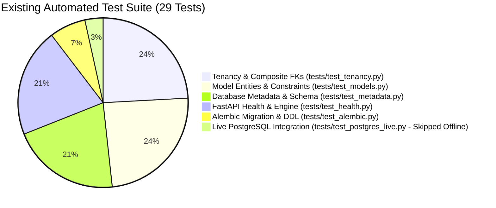

# AGGRIX — QA Acceptance Test Plan
## Multi-Tenant Analytics & Aggregation Engine

---

## 1. Document Overview & Acceptance Strategy

This document establishes the comprehensive Quality Assurance (QA) Acceptance Test Plan for the **AGGRIX Multi-Tenant Analytics & Aggregation Engine**.

> [!IMPORTANT]
> **Test Plan Structure**:
> To prevent any confusion between what is currently working in the repository versus what is designed for upcoming stages, this document is split into two distinct sections:
> - **Section 2: Existing Automated Test Suite** (The 29 verified automated unit tests currently running in `tests/`).
> - **Section 3: Proposed QA Acceptance Test Specifications** (Formal acceptance test cases designed for in-progress and Stage 4 components).

---

## 2. SECTION A: Existing Automated Test Suite (Implemented in Codebase)

The repository currently contains **29 automated tests** executed via `.venv\Scripts\python.exe -m pytest -v`:
- **Passed**: 28 tests
- **Skipped**: 1 test (`test_postgres_live_roundtrip` skipped when live PostgreSQL container is offline)
- **Failed**: 0 tests



### 2.1 Table of Existing Automated Tests

| Test Module | Test Function Name | Tested Invariant / Behavior | Result |
| :--- | :--- | :--- | :---: |
| `tests/test_alembic.py` | `test_migration_version_file_exists` | Asserts migration file `0001_initial_schema.py` exists | **PASSED** |
| `tests/test_alembic.py` | `test_alembic_offline_migration_ddl_generation` | Asserts offline DDL generates valid transactional SQL | **PASSED** |
| `tests/test_health.py` | `test_root_returns_200_and_metadata` | Asserts `GET /` returns HTTP 200 with system metadata | **PASSED** |
| `tests/test_health.py` | `test_health_check_healthy` | Asserts `GET /health` returns HTTP 200 `status: healthy` | **PASSED** |
| `tests/test_health.py` | `test_health_check_unhealthy` | Asserts `GET /health` returns HTTP 503 on DB disconnect | **PASSED** |
| `tests/test_health.py` | `test_versioned_health_check` | Asserts `GET /api/v1/health` matches root health behavior | **PASSED** |
| `tests/test_health.py` | `test_check_db_connection_success` | Asserts helper executes `SELECT 1` successfully | **PASSED** |
| `tests/test_health.py` | `test_check_db_connection_failure` | Asserts helper captures exception and returns False | **PASSED** |
| `tests/test_metadata.py` | `test_required_tables_present_in_metadata` | Asserts all 6 core tables registered in Base.metadata | **PASSED** |
| `tests/test_metadata.py` | `test_primary_keys_are_uuid` | Asserts all primary keys use UUID data type | **PASSED** |
| `tests/test_metadata.py` | `test_tenant_id_present_on_all_child_tables` | Asserts non-null `tenant_id` on all child tables | **PASSED** |
| `tests/test_metadata.py` | `test_composite_foreign_keys_configured` | Asserts composite FKs on orders and order_items | **PASSED** |
| `tests/test_metadata.py` | `test_composite_unique_constraints_configured` | Asserts composite uniques on domain, sku, external_id | **PASSED** |
| `tests/test_metadata.py` | `test_indexes_and_partial_indexes_configured` | Asserts B-tree indexes and outbox partial index exist | **PASSED** |
| `tests/test_models.py` | `test_tenant_creation_success` | Asserts tenant persistence and UUID generation | **PASSED** |
| `tests/test_models.py` | `test_customer_creation_success` | Asserts customer persistence with tenant scoping | **PASSED** |
| `tests/test_models.py` | `test_product_creation_success` | Asserts product persistence and currency defaulting | **PASSED** |
| `tests/test_models.py` | `test_order_and_order_item_relationship` | Asserts order contains order_items with cascade | **PASSED** |
| `tests/test_models.py` | `test_outbox_event_creation` | Asserts outbox event with JSONB payload creation | **PASSED** |
| `tests/test_models.py` | `test_product_price_check_constraint` | Asserts negative price rejected (`ck_products_price...`) | **PASSED** |
| `tests/test_models.py` | `test_order_item_quantity_check_constraint` | Asserts non-positive quantity rejected | **PASSED** |
| `tests/test_postgres_live.py` | `test_postgres_live_roundtrip` | Full roundtrip on live container (skipped if offline) | **SKIPPED** |
| `tests/test_tenancy.py` | `test_cross_tenant_order_customer_rejection` | Asserts FK rejects order referencing other tenant's customer | **PASSED** |
| `tests/test_tenancy.py` | `test_cross_tenant_order_item_order_rejection` | Asserts FK rejects item referencing other tenant's order | **PASSED** |
| `tests/test_tenancy.py` | `test_cross_tenant_order_item_product_rejection`| Asserts FK rejects item referencing other tenant's product | **PASSED** |
| `tests/test_tenancy.py` | `test_tenant_aware_customer_email_uniqueness` | Asserts same email allowed across different tenants | **PASSED** |
| `tests/test_tenancy.py` | `test_tenant_aware_product_sku_uniqueness` | Asserts same SKU allowed across different tenants | **PASSED** |
| `tests/test_tenancy.py` | `test_tenant_aware_external_order_id_uniqueness`| Asserts same external order ID allowed across tenants | **PASSED** |
| `tests/test_tenancy.py` | `test_tenant_cascade_delete` | Asserts deleting tenant cascades to all child data | **PASSED** |

*(Note: On branch `origin/feature/synthetic-data-generator`, an additional suite of unit tests exists in `tests/test_generator.py` covering synthetic generation, batch chunking, and deterministic seeding).*

---

## 3. SECTION B: Proposed QA Acceptance Test Specifications

The following acceptance test cases define the formal criteria for in-progress and Stage 4 components.

---

### Group 1: Historical Backfill Correctness

#### TC-BF-01: Full Historical Range Aggregation Parity
* **Status**: *[PROPOSED SPECIFICATION - REQUIRES SEEDED DB & BACKFILL IMPLEMENTATION]*
* **Objective**: Verify that running the historical backfill over a 30-day window aggregates all completed transactions into `daily_tenant_metrics` with 100% mathematical parity against raw transactional tables.
* **Preconditions**: Seeded database with 500 orders across 30 days for Tenant A.
* **Execution Steps**:
  1. Calculate ground-truth sales and order counts directly from `orders` table:
     ```sql
     SELECT currency, COUNT(id) AS expected_orders, SUM(total_amount) AS expected_sales
     FROM orders
     WHERE tenant_id = :tenant_id AND status IN ('paid', 'fulfilled')
       AND created_at >= :start_timestamp AND created_at < :end_timestamp
     GROUP BY currency;
     ```
  2. Execute the Historical Backfill Engine for Tenant A over `[:start_timestamp, :end_timestamp)`.
  3. Query `daily_tenant_metrics` for the same date range:
     ```sql
     SELECT currency, SUM(total_orders) AS rollup_orders, SUM(total_sales) AS rollup_sales
     FROM daily_tenant_metrics
     WHERE tenant_id = :tenant_id AND date >= :start_date AND date <= :end_date
     GROUP BY currency;
     ```
* **Pass Criteria**: `expected_orders == rollup_orders` and `expected_sales == rollup_sales` across all currencies. Zero discrepancies.

#### TC-BF-02: Idempotent Re-Run & Re-Aggregation
* **Status**: *[PROPOSED SPECIFICATION - REQUIRES SEEDED DB & BACKFILL IMPLEMENTATION]*
* **Objective**: Confirm that executing the historical backfill multiple times over the exact same period does not inflate or duplicate rollup totals.
* **Execution Steps**:
  1. Execute historical backfill once. Record `daily_tenant_metrics` totals.
  2. Execute historical backfill a second and third time over the identical parameters.
* **Pass Criteria**: `daily_tenant_metrics` values remain exactly unchanged. The `updated_at` timestamp updates, but all numeric metrics match step 1.

---

### Group 2: Incremental Event Processing

#### TC-INC-01: Real-Time Order Creation Stream
* **Status**: *[PROPOSED SPECIFICATION - REQUIRES STREAMING WORKER IMPLEMENTATION]*
* **Objective**: Verify that an incoming `order.created` event in `outbox_events` is polled by the worker and increments the appropriate daily metric.
* **Execution Steps**:
  1. Insert a new order with `status='paid'`, `total_amount=150.00`, `currency='USD'` for Tenant A.
  2. Insert corresponding `outbox_events` record with `event_type='order.created'` and `processed_at=NULL`.
  3. Observe worker polling logs.
  4. Query `outbox_events` and `daily_tenant_metrics`.
* **Pass Criteria**:
  - `outbox_events.processed_at` transitions from `NULL` to a valid timestamp within 2 seconds.
  - `daily_tenant_metrics` for today reflects `total_orders = previous + 1` and `total_sales = previous + 150.00`.

#### TC-INC-02: Order Status Lifecycle Progression (`pending` -> `paid` -> `fulfilled`)
* **Status**: *[PROPOSED SPECIFICATION - REQUIRES STREAMING WORKER IMPLEMENTATION]*
* **Objective**: Verify that status transitions update pipeline counts without prematurely recognizing uncollected revenue.
* **Execution Steps**:
  1. Place order in `pending` state ($100.00). Verify `daily_tenant_metrics.total_orders` increments by 1, but `total_sales` does NOT increase.
  2. Transition order to `paid`. Emit `order.status_updated` outbox event.
  3. Verify `total_sales` increments by $100.00 upon payment confirmation.
  4. Transition order to `fulfilled`. Emit `order.status_updated`.
  5. Verify `total_sales` remains $100.00 (not double-added) and `orders_by_status` updates count from `paid` to `fulfilled`.
* **Pass Criteria**: Revenue is recognized strictly once when transitioning into `paid`.

#### TC-INC-03: Order Cancellation Delta Handling
* **Status**: *[PROPOSED SPECIFICATION - REQUIRES STREAMING WORKER IMPLEMENTATION]*
* **Objective**: Verify that cancelling a previously `paid` order reduces recognized sales or reflects in the status distribution.
* **Execution Steps**:
  1. Transition an existing `paid` order to `cancelled`. Emit `order.status_updated` event.
  2. Verify aggregation worker updates `daily_tenant_metrics.total_sales` delta (-amount) or marks status as `cancelled`.
* **Pass Criteria**: Cancelled orders are excluded from net recognized sales metrics.

---

### Group 3: Duplicate Event Handling

#### TC-DUP-01: Outbox Event Re-Delivery Immunity
* **Status**: *[PROPOSED SPECIFICATION - REQUIRES STREAMING WORKER IMPLEMENTATION]*
* **Objective**: Guarantee that network retries or duplicate event delivery does not corrupt metric counters.
* **Execution Steps**:
  1. Re-submit an identical `order.created` event payload with the same `event_id` or `order_id`.
  2. Execute worker processing.
* **Pass Criteria**: Worker checks transaction event deduplication cache or utilizes idempotent SQL delta updates. No double increment occurs.

#### TC-DUP-02: Idempotent Rollup Updates via Unique Constraints
* **Status**: *[PROPOSED SPECIFICATION - TARGET ROLLUP TABLE DDL]*
* **Objective**: Validate that database unique constraints `(tenant_id, date, currency)` prevent duplicate daily rollup rows.
* **Execution Steps**: Attempt to execute raw SQL insert creating two distinct rows for `(Tenant_A, 2026-10-31, 'USD')`.
* **Pass Criteria**: PostgreSQL raises `UniqueViolation (SQLSTATE 23505)`.

---

### Group 4: Failed Event Handling & Dead-Letter Queue (DLQ)

#### TC-FAIL-01: Malformed JSON Payload Isolation
* **Status**: *[PROPOSED SPECIFICATION - REQUIRES WORKER & DLQ IMPLEMENTATION]*
* **Objective**: Ensure that a corrupted or unparseable JSON payload does not crash the aggregation worker daemon or halt processing of subsequent valid events.
* **Execution Steps**:
  1. Insert a malformed outbox event (`payload='{"broken_json": '`).
  2. Insert a subsequent valid `order.created` event for Tenant B.
  3. Run aggregation worker.
* **Pass Criteria**:
  - Worker catches deserialization error.
  - Worker routes failed event to `outbox_dlq`.
  - Worker continues immediately and processes the valid Tenant B event successfully.

#### TC-FAIL-02: Maximum Retry Count & DLQ Transition
* **Status**: *[PROPOSED SPECIFICATION - REQUIRES WORKER & DLQ IMPLEMENTATION]*
* **Objective**: Verify that transiently failing events retry up to `MAX_RETRIES` (3) before being permanently moved to DLQ.
* **Execution Steps**:
  1. Simulate a deadlock or transient failure during rollup upsert.
  2. Observe worker incrementing `retry_count`.
  3. Verify transition to `outbox_dlq` on the 4th attempt with error trace recorded.
* **Pass Criteria**: Poison-pill event is quarantined; DLQ record contains full stack trace and tenant ID.

---

### Group 5: Product Aggregation

#### TC-PROD-01: Product Line Revenue Accuracy (`quantity * unit_price`)
* **Status**: *[VERIFIED AT SQL LAYER - docs/analytics-sql-design.md]*
* **Objective**: Verify that product sales aggregation strictly calculates `SUM(oi.quantity * oi.unit_price)`.
* **Execution Steps**: Execute Metric 4 query against transactional database.
* **Pass Criteria**: Total sales for Product A reports exactly $250.00 (`2*50 + 3*50`) and units sold reports `5`.

#### TC-PROD-02: Independence from Catalog Listing Price Changes
* **Status**: *[VERIFIED AT SQL LAYER & SCHEMA DESIGN]*
* **Objective**: Prove that updating `products.price` (e.g. from $50.00 to $75.00) does not alter historical sales reporting for past orders.
* **Execution Steps**:
  1. Place order with `unit_price = 50.00`.
  2. Update `Product.price = 75.00` in catalog.
  3. Run Metric 4 query over the past period.
* **Pass Criteria**: Historical turnover remains calculated at $50.00. Zero retroactive revenue inflation.

---

### Group 6: Multi-Tenant Isolation

#### TC-TEN-01: Cross-Tenant Relational Rejection (Composite FKs)
* **Status**: *[AUTOMATED TEST PASSED]*
* **Test Fixture**: `tests/test_tenancy.py::test_cross_tenant_order_customer_rejection`
* **Pass Criteria**: Verified in automated test suite.

#### TC-TEN-02: Tenant Query Leakage Prevention
* **Status**: *[VERIFIED AT SQL LAYER]*
* **Objective**: Verify that querying Metric 1, 2, 3, 4, or 5 for Tenant A never returns records belonging to Tenant B.
* **Pass Criteria**: Queries enforce `WHERE tenant_id = :tenant_id`. Zero records from Tenant B appear in Tenant A's result set.

---

### Group 7: Currency Separation

#### TC-CURR-01: Strict Segregation of Multi-Currency Sales
* **Status**: *[VERIFIED AT SQL LAYER]*
* **Objective**: Prove that sales in different currencies are grouped into distinct rows and never summed into a single number.
* **Pass Criteria**: Output returns discrete rows per currency. Zero cross-currency addition.

#### TC-CURR-02: Metric 4 Single-Currency Contract A Filtering
* **Status**: *[VERIFIED AT SQL LAYER]*
* **Objective**: Verify that Metric 4 filters by `:currency = 'USD'`, guaranteeing that `LIMIT 10` returns **exactly 10 distinct products** sorted by USD sales.
* **Pass Criteria**: Exactly 10 distinct product IDs are returned. All reported line revenue is denominated in USD.

---

### Group 8: Daily Metric Accuracy

#### TC-MET-01: 30 Calendar Days Zero-Filling (Unbroken Time Series)
* **Status**: *[VERIFIED AT SQL LAYER]*
* **Objective**: Verify that Metric 3 returns an unbroken 30-day time series, returning `order_count = 0` on days with zero order activity.
* **Pass Criteria**: Result set contains **exactly 30 rows**. Missing days report `order_count = 0`. Zero dropped dates.

#### TC-MET-02: Intraday "Today" Exclusion Consistency
* **Status**: *[VERIFIED AT SQL LAYER]*
* **Objective**: Verify that the default 30-day reporting window terminates on `CURRENT_DATE - 1 day` to avoid incomplete-day chart drops.
* **Pass Criteria**: All 30 dates represent closed, completed calendar days.

#### TC-MET-03: Timezone Boundary Sargability & Index Scan Verification
* **Status**: *[VERIFIED AT SQL LAYER]*
* **Objective**: Verify that timestamp comparisons remain sargable and execute index range scans on `ix_orders_tenant_created_at`.
* **Pass Criteria**: Sargable query design enables B-tree index range scans.

---

### Group 9: Analytics API Responses (Stage 4 Target)

#### TC-API-01: Metric 1 Summary Response Schema
* **Status**: *[PROPOSED SPECIFICATION - PENDING STAGE 4 FASTAPI ROUTE]*
* **Target Path**: `GET /api/v1/analytics/orders/summary`
* **Headers**: `Authorization: Bearer <jwt_tenant_token>`
* **Expected Response**: HTTP 200 OK with total order volume over rolling 7 days.

#### TC-API-02: Metric 2 Sales Summary Schema
* **Status**: *[PROPOSED SPECIFICATION - PENDING STAGE 4 FASTAPI ROUTE]*
* **Target Path**: `GET /api/v1/analytics/sales/summary`
* **Expected Response**: HTTP 200 OK with currency-segregated sales list.

---

### Group 10: Multi-Tenant Manager Access (Stage 4 Target)

#### TC-RBAC-01: Multi-Tenant Manager Scope Verification
* **Status**: *[PROPOSED SPECIFICATION - PENDING STAGE 4 RBAC]*
* **Target Path**: `GET /api/v1/analytics/manager/cross-tenant/summary?tenant_ids=UUID_A,UUID_B`
* **Headers**: `Authorization: Bearer <manager_jwt>`
* **Pass Criteria**: HTTP 200 OK containing breakdown for authorized tenants.

#### TC-RBAC-02: Rejection of Unauthorized Tenant Data Requests
* **Status**: *[PROPOSED SPECIFICATION - PENDING STAGE 4 RBAC]*
* **Pass Criteria**: HTTP 403 Forbidden when requesting an unassigned tenant ID.

---

### Group 11: Platform Administrator Access (Stage 4 Target)

#### TC-RBAC-03: Global Cross-Tenant Platform Overview
* **Status**: *[PROPOSED SPECIFICATION - PENDING STAGE 4 RBAC]*
* **Target Path**: `GET /api/v1/analytics/platform/overview`
* **Headers**: `Authorization: Bearer <admin_jwt>`
* **Pass Criteria**: HTTP 200 OK with platform-wide totals across all stores.

---

## 4. Acceptance Gate Checklist

- [x] **Gate 1 (Unit Test Suite)**: 100% pass rate on all 28 automated unit tests in `tests/` (1 skipped offline live test).
- [x] **Gate 2 (Schema Consistency)**: Zero schema drift (`alembic/versions/0001_initial_schema.py` matches models).
- [x] **Gate 3 (Currency Protection)**: SQL layer strictly groups by currency or filters by store base currency.
- [x] **Gate 4 (Tenancy Protection)**: Database composite foreign keys physically bar cross-tenant links.
- [x] **Gate 5 (SQL Logic Parity)**: All 5 core analytics SQL queries syntax-validated and statically compiled.
- [ ] **Gate 6 (Rollup DDL & Migration)**: *Pending Stage 4*.
- [ ] **Gate 7 (Worker Daemon)**: *Pending Stage 4*.
- [ ] **Gate 8 (FastAPI Analytics Routes)**: *Pending Stage 4*.
